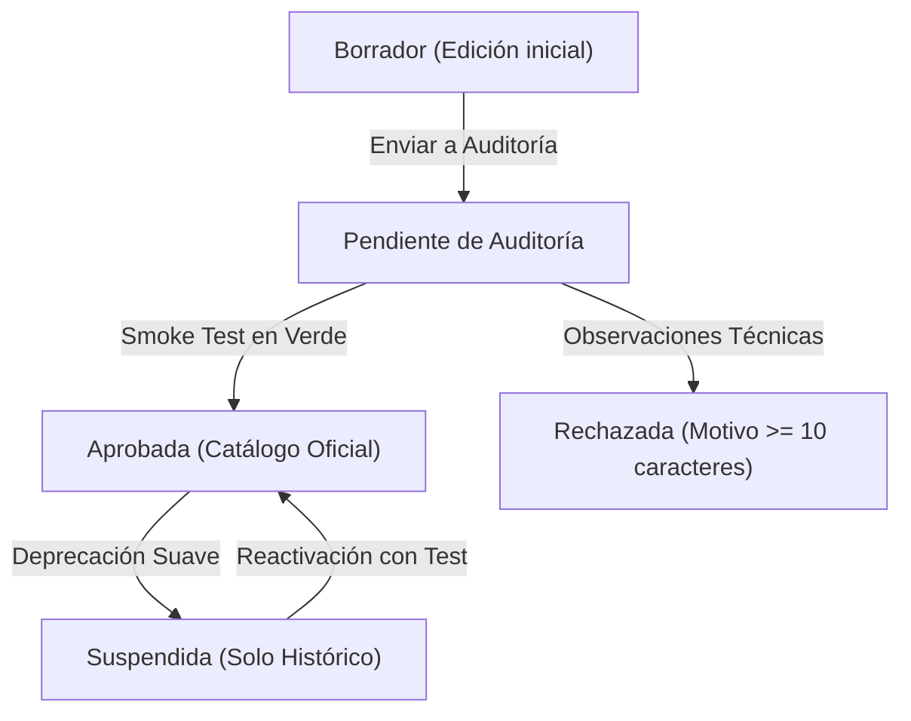

# Manual de Administración del Sistema — SOLV

Guía operativa, técnica y de gestión para administradores de la plataforma SOLV.

---

## 1. Visión General e Identidad del Sistema

### 1.1 Propósito y Alcance
La plataforma SOLV está diseñada para centralizar la gestión, ejecución y evaluación de laboratorios virtuales de programación en entornos académicos. Permite a las instituciones educativas proporcionar a sus estudiantes entornos de desarrollo listos para usar y sistemas de calificación automática de código, manteniendo el control de los recursos del servidor y la seguridad de la infraestructura.

### 1.2 Glosario de Términos
- **Laboratorio Interactivo (IDE):** Entorno de desarrollo completo basado en navegador web (OpenVSCode Server) con terminal integrada, explorador de archivos y persistencia de código durante el semestre.
- **Juez Evaluador (Sandbox):** Entorno de ejecución rápida y aislada que compila y ejecuta código fuente frente a casos de prueba predefinidos para emitir una calificación automática.
- **Contenedor Docker:** Unidad ligera y aislada que empaqueta el sistema operativo base, los compiladores, intérpretes y herramientas necesarias para cada práctica.
- **Límite de Recursos (cgroups v2):** Mecanismo del kernel de Linux que restringe la cantidad de memoria RAM y procesador (CPU) que un contenedor puede utilizar.
- **Análisis Estático (Semgrep):** Verificación previa del código fuente para detectar llamadas al sistema o librerías prohibidas antes de permitir su compilación.

### 1.3 Matriz de Roles y Responsabilidades
| Rol | Alcance y Responsabilidades |
| :--- | :--- |
| **Administrador Central** | Control global de infraestructura, gestión de periodos académicos, aprobación de plantillas de entorno, fijación de límites de hardware, asignación de docentes a materias y auditoría de eventos. |
| **Docente** | Creación de actividades pedagógicas, configuración de ejercicios en el juez, supervisión de entregas de estudiantes y consulta de plantillas aprobadas. |
| **Estudiante** | Acceso a sus materias inscritas, desarrollo en su laboratorio interactivo personal y envío de soluciones para evaluación automática. |

---

## 2. Entornos de Laboratorio y Evaluación

### 2.1 Comparativa Técnica de Entornos
SOLV ofrece dos modalidades de ejecución según la necesidad pedagógica:

| Característica | Laboratorio Interactivo (IDE) | Juez Evaluador (Sandbox) |
| :--- | :--- | :--- |
| **Objetivo** | Desarrollo de proyectos, tareas extensas y aprendizaje guiado. | Exámenes cronometrados y evaluación automática de algoritmos. |
| **Interfaz** | Editor visual completo en el navegador web con terminal. | Sin interfaz gráfica. Proceso automatizado por API. |
| **Persistencia** | Almacena archivos en un volumen de disco asignado al estudiante. | Efímero. Los archivos temporales se destruyen al finalizar la prueba. |
| **Servicios Adicionales** | Admite bases de datos auxiliares (PostgreSQL, MariaDB) en red local. | Aislado totalmente sin bases de datos auxiliares. |
| **Acceso a Red** | Conectividad restringida a la red local del laboratorio. | Aislamiento estricto sin salida a red (`network_mode: none`). |
| **Consumo de Memoria** | Mayor asignación para soportar el editor web y compiladores. | Asignación compacta dimensionada para una prueba individual. |

### 2.2 Políticas de Memoria y Derivación Automática
Para garantizar estabilidad en servidores on-premise compartidos, SOLV calcula de forma automática y determinística el perfil de memoria cgroups v2 a partir de la memoria base (`base_ram_mb`):

$$\text{Memoria Mínima Garantizada } (memory.min) = \frac{\text{base\_ram\_mb}}{2}$$

$$\text{Umbral de Throttling } (memory.high) = \text{base\_ram\_mb} \times 1.5$$

$$\text{Límite Máximo Duro } (memory.max) = \text{base\_ram\_mb} \times 2$$

- **`memory.min` (50%):** Memoria garantizada por el kernel que nunca será reclamada en situaciones de estrés.
- **`memory.high` (150%):** Umbral donde el sistema operativo ralentiza las asignaciones de páginas adicionales para evitar cortes abruptos.
- **`memory.max` (200%):** Límite estricto e infranqueable; superarlo activa inmediatamente el mecanismo de corte por OOM (Out Of Memory).

**Ejemplo de dimensionamiento para una base de 1024 MB:**
- Memoria mínima garantizada: 512 MB.
- Umbral de contención: 1536 MB.
- Límite absoluto de corte (OOM): 2048 MB.

### 2.3 Perfiles Recomendados por Lenguaje
- **C / C++:** 512 MB en Juez Evaluador / 1024 MB en Laboratorio Interactivo.
- **Python:** 512 MB en Juez Evaluador / 1024 MB en Laboratorio Interactivo.
- **Java / OpenJDK:** 1024 MB en Juez Evaluador / 1536 MB a 2048 MB en Laboratorio Interactivo (por la reserva de memoria de la JVM).
- **Node.js / TypeScript:** 1536 MB a 2048 MB en Laboratorio Interactivo (para soportar `node_modules` y compilación en segundo plano).
- **Go:** 512 MB en Juez Evaluador / 1024 MB en Laboratorio Interactivo.

---

## 3. Gestión de Infraestructura y Contenedores

### 3.1 Requisitos de Imágenes Docker
- **Prohibición de la etiqueta `:latest`:** Está estrictamente prohibido utilizar `:latest`. Se deben especificar siempre versiones inmutables (ejemplo: `python:3.12-slim-bookworm`). Esto asegura que los ejercicios se ejecuten exactamente igual en cualquier momento.
- **Variantes Ligeras (`-slim`):** Se recomienda priorizar imágenes basadas en Debian Slim (`-slim`) por su balance entre tamaño reducido y compatibilidad con librerías nativas.
- **Variantes Alpine (`-alpine`):** Utilizarlas únicamente cuando se haya comprobado que las dependencias del curso son totalmente compatibles con la librería `musl-libc`.

### 3.2 Ciclo de Vida y Gobernanza de Plantillas
El ciclo de vida de una plantilla asegura que ningún entorno alcance a los estudiantes sin validación técnica previa:

- **Borrador:** Estado inicial de edición técnica. Solo visible para el autor.
- **Pendiente de Auditoría:** Solicitud enviada a revisión técnica. Requiere la ejecución obligatoria de una prueba de entorno (smoke test) para validar que la imagen descargue y responda.
- **Aprobada:** Plantilla validada e integrada en el catálogo institucional para su uso en materias y laboratorios.
- **Rechazada:** Plantilla observada por no cumplir los requisitos técnicos. Requiere un motivo de justificación de al menos 10 caracteres.
- **Suspendida:** Desactivación temporal de una plantilla obsoleta sin eliminar los historiales ni entornos de cursos anteriores.

---

## 4. Gestión Académica y Operativa

### 4.1 Periodos Académicos (Semestres)
- Los periodos definen el rango de fechas en que las materias están activas.
- Un periodo con fecha final vencida no puede establecerse como activo ni recibir nuevas inscripciones.
- No es posible eliminar un periodo que tenga materias asociadas.

### 4.2 Cursos y Asignación de Docentes
- Cada materia creada pertenece a un periodo académico y cuenta con un docente titular responsable.
- Si un docente deja una cátedra, el Administrador puede reasignar la materia a otro docente registrado sin perder la información del curso ni los laboratorios de los estudiantes.

### 4.3 Directorio de Estudiantes y Desbloqueo de Memoria
- El Administrador puede consultar el estado de cada cuenta de estudiante (Activo o Suspendido).
- **Desbloqueo por exceso de memoria (Reset OOM):** Cuando un estudiante supera repetidamente el límite de memoria de su laboratorio, su acceso queda restringido. El Administrador puede restablecer el contador de penalizaciones ingresando una justificación de al menos 10 caracteres.

---

### 4.4 Invitaciones a Docentes

Al registrar un docente, SOLV envía una invitación por correo para que cree su cuenta institucional.

- **Vigencia:** cada invitación vence a las 72 horas. Pasado ese plazo, el enlace ya no permite completar el registro.
- **Reenviar:** genera una invitación nueva con otras 72 horas de vigencia para el mismo correo.
- **Revocar:** anula el enlace vigente; el docente no podrá crear la cuenta con esa invitación.
- **Pendientes (72h):** la pestaña cuenta sólo invitaciones vigentes que todavía no fueron aceptadas.

## 5. Monitoreo, Salud y Auditoría

### 5.1 Métricas de Hardware en Tiempo Real
El panel principal de administración presenta indicadores de salud del servidor:
- **Uso de CPU:** Porcentaje de procesamiento actual respecto a la capacidad del servidor.
- **Uso de Memoria RAM:** Memoria ocupada por el sistema y los contenedores frente al total disponible.
- **Contenedores Activos:** Número de laboratorios interactivos en ejecución simultánea.

### 5.2 Registro de Auditoría
Las acciones sensibles quedan registradas con identificación de usuario, fecha, dirección IP y detalle del cambio:
- Registro y aprobación de plantillas.
- Modificación o suspensión de estados de plantillas.
- Reasignación de docentes en materias.
- Restablecimiento de penalizaciones de memoria de estudiantes.
- Acciones de emergencia sobre el servidor.

---

## 6. Solución de Problemas Frecuentes

### 6.1 Contenedor detenido por falta de memoria (Error OOM)
- **Causa:** El código ejecutado por el usuario consumió más memoria RAM que el límite máximo asignado al contenedor.
- **Solución:** 
  1. Revisar si el código contiene bucles infinitos, fugas de memoria o estructuras de datos sobredimensionadas.
  2. Si la práctica requiere legítimamente más memoria, el Administrador puede editar la plantilla y aumentar la memoria base (`base_ram_mb`).
  3. Restablecer las penalizaciones del estudiante desde el módulo de Estudiantes.

### 6.2 Error al verificar imagen Docker
- **Causa:** La imagen no existe en el registro, se utilizó la etiqueta prohibida `:latest`, o la descarga superó el tiempo de espera.
- **Solución:**
  1. Comprobar que el nombre de la imagen esté escrito correctamente (ejemplo: `gcc:14-bookworm`).
  2. Reemplazar cualquier referencia a `:latest` por un número de versión fijo.
  3. Verificar que el servidor cuente con conexión a internet para descargar la imagen por primera vez.

### 6.3 Código rechazado por análisis estático (Semgrep)
- **Causa:** El archivo de código contiene llamadas al sistema prohibidas (como manipulación directa de procesos, accesos no permitidos al sistema de archivos o apertura de conexiones de red no autorizadas).
- **Solución:** Explicar al estudiante que la solución debe enfocarse en la lógica algorítmica solicitada sin invocar comandos del sistema operativo.

### 6.4 Conflicto al crear materia o periodo
- **Causa:** Se intenta registrar una materia con un código duplicado o activar un periodo académico cuya fecha de fin ya expiró.
- **Solución:** Verificar que el código de la materia sea único y que las fechas del periodo correspondan al calendario académico vigente.

## 7. Constructor de Plantillas de Entornos

El Constructor de Plantillas crea los entornos que los docentes eligen al preparar un ejercicio. Cada plantilla se registra una vez y se reutiliza en todas las materias: define la modalidad, las tecnologías disponibles y la memoria que recibe cada estudiante.

Se abre desde **Plantillas Docker → Nueva Plantilla**. Mientras navega por la aplicación, el constructor conserva un borrador del formulario; al publicar, el borrador se descarta.

### 7.1 Paso 1 — Propósito y Datos del Entorno

- **Modalidad:** con editor, para que el estudiante trabaje en un entorno de desarrollo completo; o de evaluación, para corregir código automáticamente por consola.
- **Habilitar también la evaluación:** convierte la plantilla en dual; el mismo entorno sirve para práctica y para corrección.
- **Nombre:** es lo que ve el docente en el catálogo y en el asistente. Debe tener al menos tres caracteres.
- **Categoría académica:** agrupa la plantilla en la biblioteca.
- **Descripción pedagógica:** opcional; explica para qué sirve.

### 7.2 Paso 2 — Arquitectura y Tecnologías

- **Lenguaje principal:** obligatorio. Al elegirlo se fija la imagen base y la memoria mínima.
- **Interfaz web, complementos y base de datos:** opcionales; sólo se ofrecen tecnologías del catálogo homologado.
- **Mapa de Herramientas:** muestra cómo se relacionan las tecnologías del catálogo.
- **Modo Visual / Modo Avanzado:** el modo avanzado expone el Dockerfile y los scripts generados para revisarlos o editarlos.
- **Asistir con IA:** disponible cuando la IA institucional está habilitada; propone una combinación de tecnologías y puede crear componentes faltantes.

### 7.3 Paso 3 — Capacidad del Aula y Memoria

- Cada opción indica la memoria por alumno y cuántos estudiantes caben a la vez.
- **Sugerido** marca la opción recomendada para la combinación elegida.
- El **mínimo requerido** lo fijan las tecnologías; el **máximo permitido** lo fija el servidor. El ajuste manual debe quedar dentro de ese rango.
- Si la memoria elegida supera la libre actual del servidor, aparece un aviso de concurrencia: la plantilla es válida, pero el cupo simultáneo dependerá de la memoria disponible al momento de la clase.

### 7.4 Comprobar funcionamiento y publicar

- **Comprobar funcionamiento** construye la imagen cuando la combinación lo requiere y verifica que los programas declarados respondan. Muestra las versiones detectadas.
- Si la configuración cambia después de la comprobación, hay que repetirla: el panel avisa y bloquea la publicación hasta entonces.
- **Publicar Plantilla Oficial** registra la plantilla en el catálogo para que los docentes puedan usarla. El panel indica el motivo exacto cuando la publicación está bloqueada (nombre incompleto, memoria fuera de rango o comprobación pendiente).
- El resultado de la comprobación se guarda con la plantilla; publicar no crea contenedores para estudiantes.

### 7.5 Guías dentro del constructor

El encabezado del constructor ofrece dos apoyos:

- **Recorrido visual:** señala dónde está cada parte de la pantalla, sin pedir datos.
- **Tutorial guiado:** explica paso a paso y comprueba el estado real del formulario; no deja avanzar mientras falte el nombre, la tecnología o la memoria válida. Se puede cerrar en cualquier momento y seguir trabajando.

## 8. Biblioteca de Modelos y Categorías

La Biblioteca concentra los modelos oficiales que el asistente ofrece a los docentes, el catálogo de tecnologías y las categorías académicas.

Ruta: **Modelos y Categorías**. Cuatro pestañas:

### 8.1 Modelos Oficiales

- Los indicadores superiores cuentan modelos totales, activos y por modalidad, además de las categorías.
- **Búsqueda:** por nombre, descripción o imagen Docker.
- **Filtros:** propósito, categoría y estado (activos o inactivos).
- **Nuevo Modelo Oficial:** promueve una plantilla aprobada a modelo del catálogo. Sin plantillas aprobadas no hay nada que promover.
- **Editar metadatos:** título, descripción y categoría.
- **Activar / desactivar:** un modelo inactivo deja de ofrecerse sin borrar su historial.
- Estados vacíos: la pantalla distingue entre catálogo sin modelos, búsqueda sin coincidencias, filtros que excluyen todo y error de carga.

### 8.2 Catálogo de Tecnologías

- Registra lenguajes, interfaces web, complementos y bases de datos.
- **Activar / desactivar** decide si la tecnología se ofrece en el constructor.
- Las tecnologías base del sistema no se pueden eliminar.
- Un complemento **huérfano** no es compatible con ningún lenguaje activo: conviene revisarlo o desactivarlo.

### 8.3 Categorías Académicas

- Crear, editar y ordenar categorías con las flechas o arrastrando.
- No se puede eliminar una categoría con modelos o plantillas asociadas.

### 8.4 Mapa del Sistema

Vista de sólo lectura que relaciona tecnologías, capas y complementos compatibles.

## 9. Configuración de Inteligencia Artificial

Ruta: **Configuración → Inteligencia Artificial**.

- **Interruptor institucional:** habilita o deshabilita la IA para toda la institución. Deshabilitada, el copiloto del constructor y las tareas asistidas dejan de ofrecerse.
- **En uso:** proveedor que recibe las solicitudes. Sólo uno puede estar en uso; al seleccionar otro, el cambio es inmediato.
- **Clave guardada:** el proveedor tiene credencial pero no está activo.
- **Sin configurar:** no tiene clave ni modelo; hay que guardar una clave para poder seleccionarlo.
- **Clave:** se almacena en el servidor y no se muestra completa. Para cambiarla se escribe una nueva y se guarda.
- **Modelo:** cada proveedor permite elegir el modelo que se usará.
- **Agregar proveedor / Ver más proveedores:** incorpora un endpoint compatible con la API de OpenAI o muestra los proveedores adicionales.

La IA nunca se ofrece a estudiantes durante una evaluación; asiste a administradores y docentes.

## 10. Mantenimiento y Consola de Emergencias

Ruta: **Auditoría → Emergencias**.

Cada operación exige la frase de confirmación exacta y un motivo de al menos 10 caracteres. La ejecución, el actor y el motivo quedan en el Registro de Auditoría.

| Operación | Impacto | Qué hace |
| :--- | :--- | :--- |
| Terminar todos los entornos | Destructiva | Detiene y destruye los contenedores activos del tenant. |
| Hibernar todos los entornos | Operativa | Pausa los contenedores activos preservando su estado. |
| Limpiar contenedores huérfanos | Operativa | Elimina contenedores que ya no pertenecen a ningún entorno registrado. |
| Purgar capas huérfanas | Operativa | Libera disco eliminando capas sin uso; no toca volúmenes nombrados. |
| Reiniciar pools | Operativa | Reinicia el pool de conexiones de PostgreSQL y los contadores de corte. |

- **Frase de confirmación:** debe escribirse tal como aparece en el diálogo; si no coincide, la operación no se ejecuta.
- **Aviso de memoria:** cuando la RAM del host supera el 90 %, el panel recomienda hibernar antes de una acción destructiva.
- **Historial:** las últimas emergencias se listan con fecha, acción y responsable, con paginación.

## 11. Guías dentro del panel administrativo

El botón `?` de la barra superior abre el Centro de ayuda de la pantalla visible. El panel reúne la explicación contextual de esa vista, las guías disponibles y el enlace a la sección correspondiente de este manual. El botón solo aparece en el área administrativa y solo cuando la pantalla tiene contenido registrado.

Cada pantalla puede ofrecer hasta dos guías:

- **Recorrido visual:** señala los elementos reales de la pantalla sin pedir datos ni detener el trabajo.
- **Tutorial guiado:** avanza paso a paso y comprueba el estado real antes de permitir el siguiente paso. Se puede cerrar en cualquier momento.

| Pantalla | Recorrido visual | Tutorial guiado |
| :--- | :---: | :---: |
| Períodos académicos | Sí | Crear y activar un período |
| Identidad (White-Label) | Sí | Aplicar la identidad institucional |
| Servidor y respaldos | Sí | Políticas, mantenimiento y respaldos |
| Inteligencia Artificial | Sí | Dejar el copiloto en uso |
| Administradores | Sí | Sumar un administrador |
| Constructor de plantillas | Sí | Sí |
| Catálogo de plantillas | — | Sí |

En Configuración cada pestaña ofrece su propio recorrido: señala únicamente los bloques de esa pestaña y no comparte pasos con las demás. Al cambiar de pestaña, el centro de ayuda muestra las guías de la pestaña abierta, no las de la página completa.

Las guías de configuración no ejecutan operaciones destructivas: archivar un período, activar el mantenimiento, revocar privilegios o eliminar un período solo se explican y quedan en manos del administrador. Cada paso que exige datos comprueba el formulario real; si falta algo, el panel indica qué completar.

El panel del tutorial se ubica en la esquina que no tapa el elemento señalado y se puede minimizar a su cabecera cuando hace falta ver una tarjeta completa; al abrir otra guía vuelve a aparecer desplegado.
