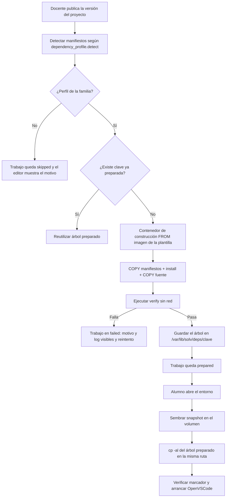

# ADR 069: Preparación de Dependencias de Proyecto por Ecosistema

- **Estado:** Aceptado
- **Implementación:** modelo de datos, semillas, cola, worker, runner, enlace al volumen, estado visible y reintento. Pendientes: la caché compartida por nodo (decisión 8), la prueba previa del perfil (decisión 5), la puesta en marcha (decisión 14), la medición del disco (decisión 15) y el multi-tenant del perfil (decisión 11).
- **Fecha:** 2026-11-11
- **Ámbito:** Docencia, catálogo de tecnologías, aprovisionamiento de entornos
- **Relacionado:** ADR-030 (catálogo y aprobación), ADR-046 (constructor de entornos e imágenes locales), ADR-050 (servicios satélite por rol), ADR-051 (PostgreSQL de aula), ADR-054 (catálogo del docente), ADR-068 (proyectos iniciales y versiones)

## Contexto

Bajo la palabra «dependencias» hoy conviven tres cosas distintas, con costos distintos y dueños distintos:

| Capa | Qué resuelve | Dónde vive hoy | Quién la paga |
| :--- | :--- | :--- | :--- |
| **Herramienta del entorno** | `python3`, `node`, `ng`, `mvn`, `pytest`, `uvicorn`, `psql` | Capa `RUN` de la imagen `solv-local/stack:<sha256>` | Una vez por plantilla, en todo el nodo |
| **Dependencia del proyecto** | `node_modules`, `.venv`, `~/.m2`, `vendor/`, `go.sum` resuelto | No existe como paso del sistema | Cada alumno, cada vez |
| **Dependencia que el alumno agrega en clase** | `npm install express`, `pip install django` | Terminal del alumno, red externa | Cada alumno, cada vez |

Lo que el sistema ya hace bien es la primera capa. `TemplateComposerService` compone el Dockerfile a partir de `template_components.build_layer_snippet`, instala complementos con el gestor declarado (`npm -g`, `pip --no-cache-dir`, `apt-get install`, `cargo install`, `go install`, `composer global require`, `dotnet tool install`) y fija el resultado en un tag inmutable por firma `sha256` (ADR-046). Las herramientas del catálogo están en la imagen, no en el volumen del alumno.

Lo que el sistema no hace es la segunda capa. El sembrado del proyecto (ADR-068) escribe archivos de texto en el volumen y no ejecuta ningún gestor de paquetes. `workspace_project_versions.text_snapshot` guarda solo el snapshot, y el contrato de importación admite 1 MiB de contenido, 300 archivos y 512 KiB por archivo. Un `node_modules` de Angular y NestJS ronda los 30.000 archivos y 600 MB: no entra como dato, ni como respaldo del docente, ni en el diff de SpeedGrader.

El `setup_script` de la plantilla tampoco es el lugar. Corre dentro del contenedor del alumno, una sola vez por volumen, con el marcador `.solv_initialized`, y el arranque del editor espera a que termine (`pureRuntimePracticeEnvironmentCmd`). Poner ahí una instalación de dependencias significa que cada alumno descarga, que el editor tarda minutos en abrir y que la clase compite por el mismo enlace.

**El síntoma se ve en Node porque Angular y NestJS son los proyectos más grandes del catálogo, pero el problema no es de Node.** Python con `requirements.txt`, Java con `pom.xml`, Go con `go.mod`, Rust con `Cargo.toml`, PHP con `composer.json`, .NET con `*.csproj` y C/C++ con `CMakeLists.txt` o `conanfile` quedan exactamente en la misma situación: el docente entrega código fuente y el alumno tiene que resolver las dependencias antes de poder compilar o ejecutar.

## Decisión

### 1. La preparación se declara en el catálogo, no se escribe por lenguaje en el código

Cada componente `runtime` de `template_components` incorpora un `dependency_profile` (JSONB, versionado). El perfil describe cómo se materializan las dependencias de un proyecto de esa familia. El backend no ramifica por lenguaje: lee el perfil y ejecuta el mismo procedimiento.

```json
{
  "version": 1,
  "detect": ["package.json"],
  "lockfiles": ["pnpm-lock.yaml", "package-lock.json", "yarn.lock", "bun.lockb"],
  "install": "corepack enable && (pnpm install --frozen-lockfile || npm ci --no-audit --no-fund)",
  "install_without_lock": "npm install --no-audit --no-fund",
  "materialize": "tree",
  "dependency_paths": ["node_modules"],
  "cache_env": { "PNPM_HOME": "/opt/solv/cache/pnpm", "npm_config_store_dir": "/opt/solv/cache/pnpm" },
  "verify": "node -e \"require('express')\"",
  "network": "build"
}
```

| Campo | Qué significa |
| :--- | :--- |
| `detect` | Archivos cuya presencia indica que el proyecto usa esta familia. Se evalúa al importar o generar el proyecto. |
| `lockfiles` | Archivos que fijan versiones exactas. Su hash forma parte de la clave de preparación. |
| `install` | Comando con lockfile. Debe ser no interactivo y determinista. |
| `install_without_lock` | Comando de respaldo cuando el proyecto no trae lockfile. |
| `materialize` | `tree` si el resultado vive dentro del proyecto (`node_modules`, `.venv`, `vendor/`); `cache` si vive fuera (`~/.m2`, `GOMODCACHE`, `~/.nuget`, `CARGO_HOME`); `none` si la familia no tiene dependencias de proyecto (C puro con `Makefile`). |
| `dependency_paths` | Rutas que produce la instalación y que deben quedar disponibles para el alumno. |
| `cache_env` | Variables de entorno de la preparación: dónde guarda el gestor lo que descarga. Mientras la caché compartida del nodo no exista, el runner remapea las rutas `/opt/solv/cache/*` dentro del árbol. No se aplican en el aula. |
| `verify` | Comprobación ejecutable de que la preparación quedó usable. No es opcional para publicar. |
| `network` | `build` cuando la preparación necesita red en el momento de construir; `none` cuando el gestor resuelve desde la caché compartida. |
| `offline_flags` | Modificadores que obligan al gestor a no consultar el índice (`PIP_NO_INDEX` con `--find-links`, `GOPROXY=off`, `mvn -o`, `cargo --offline`, `npm ci --offline`). Sin ellos la caché da velocidad, no garantía. |

El perfil no duplica lo que ya existe: `install_mode`, `package_names` y `tools_provided` siguen describiendo la herramienta de la capa 1.

### 2. Se materializa una vez por versión, no una vez por alumno

La preparación corre en un contenedor de construcción gobernado, derivado de la imagen de la plantilla:

```dockerfile
FROM solv-local/stack:<sha256 de la plantilla>
COPY <manifiestos> /home/workspace/<proyecto>/
RUN <install del perfil>
COPY <resto del snapshot> /home/workspace/<proyecto>/
```

La implementación no construye una imagen: el runner escribe los archivos de la versión en el árbol y ejecuta las dos pasadas dentro de un contenedor efímero con ese mismo orden. El resultado es el mismo y no deja una imagen por versión que después haya que podar.

El resultado se publica en un directorio del host, no en una imagen:

```
/var/lib/solv/deps/<clave>/
```

con

```
clave = sha256(digest de la imagen de la plantilla
              + id de workspace_project_version
              + versión del perfil
              + hash de los lockfiles)
```

Dos versiones del mismo proyecto con el mismo lockfile comparten `clave`. Dos proyectos distintos con el mismo stack pero distinto lockfile no. Un cambio de plantilla cambia el digest y fuerza preparación nueva.

La copia de manifiestos antes del código fuente es deliberada: deja la instalación en una capa que se reutiliza aunque cambie el código del ejercicio. Es el mismo principio que ya usa la compilación de imágenes del nodo.

### 3. Al alumno se le enlaza el árbol, no se le copia

Al sembrar el volumen (después de escribir el snapshot y antes de arrancar OpenVSCode), un contenedor auxiliar sin red monta el volumen en `/environment` y el árbol preparado en solo lectura, y ejecuta `cp -al` para crear enlaces duros en la misma ruta absoluta que vio la preparación.

Consecuencias de los enlaces duros:

- Los bytes se guardan una vez por `clave` **solo si el enlace duro es posible**. Con Docker, cada volumen montado y el árbol son montajes distintos, y el kernel rechaza el enlace entre montajes con `EXDEV` (`Cross-device link`) aunque compartan superbloque: medido en el servidor con `/dev/mapper/ubuntu--vg` en los tres montajes. En la práctica el paso cae a copia y cada alumno paga su árbol; la deduplicación queda en la decisión 17.
- Si el alumno borra o reemplaza un archivo, solo se rompe su enlace. El árbol preparado y los volúmenes de sus compañeros quedan intactos.
- Si el alumno corre `npm install <paquete>`, el gestor escribe archivos nuevos y reemplaza los que cambien; el comportamiento es el de un árbol propio con copia al escribir, sin ninguna capa especial.

La ruta absoluta debe ser la misma en la preparación y en el volumen (`/home/workspace/<proyecto>`). Los entornos virtuales de Python, los `shebang` de scripts y algunos lockfiles guardan rutas absolutas; preparar en `/opt/solv/...` y enlazar en `/home/workspace/...` rompería `.venv`.

Si el sistema de archivos del nodo no admite enlaces duros entre el directorio preparado y el volumen, el mismo paso cae a una copia normal (`cp -a`) y lo informa en su salida. Que la raíz de preparados y los volúmenes compartan partición es un requisito de despliegue, no una preferencia: fuera de él, cada alumno paga su copia.

### 4. La preparación se ata a la versión publicada, no al alumno

El estado no vive en `workspace_project_versions`: vive en `dependency_preparation_jobs`, una fila por versión con clave foránea compuesta `(version_id, tenant_id, project_id)` y unicidad por `version_id`. Un solo dueño del estado, y el historial de versiones queda sin columnas que se desincronicen.

| Columna | Uso |
| :--- | :--- |
| `preparation_key` | Clave de 64 hex del árbol preparado |
| `status` | `pending`, `running`, `prepared`, `failed`, `skipped` |
| `attempts` | Intentos consumidos, con la espera creciente del worker |
| `message` | Motivo legible para el docente |
| `log_path`, `tree_path`, `bytes` | Log por intento, ruta del árbol y tamaño materializado |

La clave se guarda con el trabajo y no se recalcula al leer: si el perfil o la imagen cambian, la clave vieja sigue identificando el árbol que se preparó con ese perfil, y una versión nueva produce una clave nueva. Reabrir un entorno no vuelve a preparar ni a enlazar: el enlace deja su clave en el diario del volumen y un volumen ya marcado no se toca, igual que la regla 12 de ADR-068. Nunca se re-prepara un volumen con trabajo del alumno.

### 5. Sin perfil o con fallo, el sistema lo dice; no improvisa

- Familia sin `dependency_profile`: la versión se publica como `skipped` y el editor del proyecto lo muestra con su motivo, en términos de consecuencia y no de defecto: las dependencias se descargan en clase. No bloquea, porque el entorno funciona: lo que cambia es dónde se paga la espera. Un aviso al elegir la plantilla se descarta: en ese momento el docente todavía no subió el proyecto, y la frase sería cierta solo a veces. El hecho aparece cuando existe el proyecto y se confirma en la vista después de publicar.
- Perfil declarado y preparación fallida: la publicación no se deshace. La preparación corre después de publicar y su desenlace queda en el trabajo de la versión, con el motivo y el log a la vista del docente, que puede reintentar. Bloquear la publicación con el resultado exigiría preparar de forma sincrónica, y eso es la prueba previa de la decisión 5, que todavía no existe.
- Comprobación de preparación: el campo `verify` debe ejecutarse en verde dentro del contenedor de construcción, con la red desactivada después de instalar. Una preparación que solo funciona con red en el arranque no está lista.
- Tecnología nueva: no puede publicarse como `runtime` sin perfil probado. El alta del catálogo exige elegir un preset o declarar uno propio, y ejecutar la prueba de contrato antes de activar la pieza.

**Alta de una tecnología nueva**

1. El administrador registra la pieza y elige una receta de familia (pip, npm, Maven, Go modules, Cargo, Composer, NuGet, apt) o escribe una propia.
2. La receta aporta los `offline_flags` y la comprobación `verify`.
3. La prueba de contrato corre dos pasadas: con red para preparar, y sin red para comprobar. La segunda es la que decide.
4. Si pasa, la pieza queda publicable y se guarda la huella del perfil. Editar cualquier campo invalida esa huella y obliga a repetir la prueba, igual que `verification_fingerprint` en las plantillas.
5. Si falla, la pieza puede usarse como herramienta, pero no para proyectos con manifiesto: queda `skipped` y el editor lo dice.
6. Una familia que no está en el catálogo no se deduce sola. Alguien tiene que escribir sus modificadores y su comprobación; la prueba decide si alcanzan.

### 6. La capa 3 se resuelve con caché compartida primero y proxy después

Instalar un paquete que el docente no previó no se puede resolver con la capa 2. El nodo expondrá una caché compartida por familia, montada en todos los laboratorios, y cada perfil declarará las variables que apuntan ahí (`PNPM_HOME`, `PIP_CACHE_DIR`, `UV_CACHE_DIR`, `GOMODCACHE`, `CARGO_HOME`, `NUGET_PACKAGES`, `GRADLE_USER_HOME`, `COMPOSER_HOME`, `BUNDLE_PATH`, `npm_config_cache`).

| Familia | Caché compartida | Proxy local para instalar en clase |
| :--- | :--- | :--- |
| Node.js | `pnpm` store / `npm` cacheados | Verdaccio |
| Python | `PIP_CACHE_DIR`, `UV_CACHE_DIR` | devpi o espejo de PyPI |
| Java | `~/.m2/repository`, `GRADLE_USER_HOME` | Nexus o Artifactory |
| Go | `GOMODCACHE`, `GOPROXY` local | Athens o `GOPROXY` con caché |
| Rust | `CARGO_HOME` | espejo de registro (sparse) |
| .NET | `NUGET_PACKAGES` | BaGet |
| PHP | `COMPOSER_HOME` | Satis o repositorio privado |
| Ruby | `BUNDLE_PATH` | geminabox |

La caché da velocidad y evita descargas repetidas; no da instalación sin internet de un paquete que nadie pidió antes. Eso último solo lo da el proxy. Hoy no existe caché compartida: cada árbol guarda sus almacenes dentro del proyecto, en `.solv-cache`, y esa caché queda como optimización de disco con la decisión 8 abierta. Los proxies se incorporan como satélites con apagado automático, con el mismo modelo de ADR-050 y ADR-051.

### 7. La detección de manifiestos es un control, no una comodidad

Al importar o generar un proyecto, el backend detecta manifiestos y los cruza contra el `runtime` de la plantilla del ejercicio:

- `package.json` en una plantilla Python: advertencia explícita antes de publicar.
- `pom.xml` y `package.json` en la misma raíz: se pregunta cuál es el proyecto principal.
- Sin manifiesto reconocible: `skipped`, con el mensaje del punto 5.

El detector vive en el catálogo (`dependency_profile.detect`), así que una familia nueva entra sin tocar el servicio.

## Estado real de las piezas que el alta de tecnología necesita

| Pieza | Qué existe hoy | Límite que importa para esta decisión |
| :--- | :--- | :--- |
| Prueba de humo | `TemplateAuditWorker.runSmokeTest` levanta un contenedor y comprueba los binarios de `tools_declared` | Esa lista la infiere Go por nombre, slug, icono e imagen (`InferRuntimeTools`). Una tecnología nueva sin preset entra sin binarios declarados y la prueba no comprueba nada. |
| Escaneo de vulnerabilidades | `runTrivyScan` con `aquasec/trivy:0.55.0` y base CVE sincronizada a diario | El resultado se guarda como telemetría (`warning`) y no rechaza una imagen ya aprobada. No inspecciona el árbol de dependencias preparado. |
| Fin de ciclo | `checkEOL` contra `endoflife.date`, cada siete días | Registra estado y fecha; no bloquea la publicación. |
| Construcción de imagen | `BuildLocalStackImage` con tag `solv-local/stack:<sha256>` | Construye una imagen por combinación de tecnologías, no un árbol de dependencias por versión de proyecto. |
| Caché de gestores | No existe. El contenedor no recibe `PIP_CACHE_DIR`, `GOMODCACHE`, `CARGO_HOME` ni `npm_config_cache` | Sin esas rutas, precargar una caché en la imagen no la vuelve usable desde el home del alumno. |
| Usuario del contenedor | `StartPracticeEnvironmentContainer` fija `User: "1000:1000"` solo cuando la referencia de imagen contiene `openvscode-server` | Las imágenes `solv-local/stack:*` no lo contienen: heredan el usuario por defecto de la base (`root` en `python:3.12-slim`, `golang:*` y `eclipse-temurin:*`). Una caché en `/root` funciona hoy por esa herencia y deja de funcionar el día que se fije el usuario sin privilegios. |

Ninguna de estas piezas está mal. Ninguna alcanza para sostener que sumar una tecnología no toca código.

## Matriz del catálogo actual

| Familia | Runtime del catálogo | Manifiestos | Instalación | Materializa | Comprobación |
| :--- | :--- | :--- | :--- | :--- | :--- |
| Python | `python-312` | `requirements.txt`, `pyproject.toml`, `uv.lock`, `poetry.lock` | `pip install -r` o `uv sync --frozen` | árbol (`.venv`) | `python -c "import <paquete>"` |
| Node.js | `node-20` y plataformas web | `package.json` + lockfile | `npm ci` o `pnpm install --frozen-lockfile` | árbol (`node_modules`) | `node -e "require('<paquete>')"` |
| Java | `java-21` | `pom.xml` (Gradle necesita una imagen que lo traiga) | `mvn -B -q dependency:go-offline` | árbol (`.solv-cache/m2`) | `mvn -o -q -DskipTests package` |
| Go | `go-122` | `go.mod`, `go.sum` | `go mod tidy && go mod download` | árbol (`.solv-cache/go-mod`, `.solv-cache/go`) | `go build ./...` con `GOPROXY=off` |
| Rust | `rust-stable` | `Cargo.toml`, `Cargo.lock` | `cargo fetch` | árbol (`.solv-cache/cargo`) | `cargo check --offline` |
| PHP | `php-83` | `composer.json`, `composer.lock` | `composer install --no-interaction` | árbol (`vendor/`) | `php -r "require 'vendor/autoload.php';"` |
| .NET | `dotnet-8` | `*.csproj`, `*.sln`, `PackageReference` | `dotnet restore` | árbol (`.solv-cache/nuget`, `obj`) | `dotnet build --no-restore` |
| C/C++ | `c-gcc13`, `cpp-gcc13` | `CMakeLists.txt`, `conanfile.txt`, `vcpkg.json` (`Makefile` solo no declara paquetes: `none`) | `cmake -S . -B build` + gestor declarado | árbol (`build/`, `vendor/`) | `cmake --build build` |
| Ruby (futura) | — | `Gemfile`, `Gemfile.lock` | `bundle install --deployment` | árbol (`vendor/bundle`) | `bundle exec ruby -e "require '<gema>'"` |
| R (futura) | — | `renv.lock` | `renv::restore()` | árbol (`renv/`) | `Rscript -e "library(<paquete>)"` |

## El flujo en simple

**Cuando el docente arma la práctica**

1. Elige un entorno del catálogo. Las herramientas ya vienen en la imagen del entorno, no se instalan por alumno.
2. Sube o genera el proyecto. Sube el código, nunca las librerías descargadas.
3. El sistema mira qué tipo de proyecto es y avisa si no coincide con el entorno elegido: un proyecto de Node sobre un entorno de Python se detiene ahí, no en clase.
4. Publica. En ese momento, una sola vez, el sistema arma todo lo que el proyecto necesita para funcionar y lo guarda como base reutilizable.

**Cuando el alumno entra**

1. Pide abrir su entorno.
2. Recibe sus archivos y su parte de la base ya armada, sin duplicar el peso para cada compañero.
3. El editor abre listo, sin esperar descargas.

**Cuando el alumno agrega algo durante la clase**

1. Ejecuta el comando de siempre en la terminal.
2. Lo que ya se descargó alguna vez sale de la caché del servidor.
3. Lo que nadie bajó se descarga una vez y queda disponible para el resto del aula.

**Cuando entra una tecnología nueva**

1. El administrador la registra en el catálogo con su receta de dependencias.
2. Una prueba arma un proyecto de juguete y comprueba que funcione sin internet.
3. Si pasa, queda disponible para los docentes; si no, no se publica.

**Por qué de esta manera**

- El trabajo pesado se paga una vez por práctica, no una vez por alumno.
- Cada lenguaje guarda sus librerías en un lugar distinto, pero el procedimiento es el mismo: la diferencia es un dato del catálogo, no una rama nueva en el código.
- Nada se instala a escondidas: si un entorno no puede preparar dependencias, se avisa antes de publicar y no en medio de la clase.

## Flujo



## Alternativas descartadas

| Alternativa | Motivo del descarte |
| :--- | :--- |
| `npm install` dentro del `setup_script`, como haría el docente hoy | Bloquea el arranque del editor, descarga una vez por alumno y otra vez por cada reapertura sin caché. Es el problema que se quiere quitar, no la solución. |
| Enlazar `node_modules` desde una ruta de la imagen | El enlace apunta a una ruta de solo lectura: la primera instalación nueva del alumno falla con `EACCES` y el error no explica nada. |
| Guardar dependencias en el snapshot del proyecto | Excede el límite de 1 MiB, 300 archivos y 512 KiB por archivo, y arruina el diff de SpeedGrader y la resta de base del antiplagio. |
| Instalar en segundo plano al arrancar el contenedor | Compite con el primer comando del alumno y hace que la misma práctica funcione o falle según el momento en que se abra. |
| Una imagen por proyecto con el proyecto dentro de `/home/workspace` | El volumen montado tapa el contenido de la imagen en esa ruta; además multiplica imágenes por ejercicio y versión, con poda difícil. |
| Arreglo específico de Node con `pnpm` y un store | Deja afuera a ocho familias del catálogo y obliga a repetir el mismo trabajo la próxima vez que se sume una tecnología. |
| Instalar dependencias al importar el ZIP en el navegador | El navegador no tiene el runtime ni la red del nodo, y el resultado no quedaría versionado junto con la publicación. |

## Consecuencias

**Positivas**

- Un proyecto se resuelve con una sola instalación por versión publicada, no por alumno. El arranque del editor deja de esperar descargas.
- El mismo procedimiento cubre las nueve familias del catálogo y las que se sumen: la diferencia está en el perfil, no en el servicio.
- La clase funciona sin internet después de publicada, y una instalación nueva durante la clase pasa por la caché del nodo.
- La versión que recibe el alumno queda atada al mismo árbol de dependencias que el docente probó, igual que ya pasa con los archivos (ADR-068).
- El disco real se mide por `clave`, pero hoy no se ahorra: el enlace cae a copia entre montajes de Docker. La duplicación por aula sigue ahí hasta resolver la decisión 17.

**Costos y cuidados**

- La publicación se vuelve más lenta: preparar un `node_modules` completo puede tardar minutos. Es tiempo del docente, una vez, y no de treinta alumnos en clase.
- Aparece un directorio de preparados que necesita política de retención y poda por referencia, igual que `PruneOrphanStackImages`.
- El contenedor de construcción necesita salida a los registros públicos. El nodo ya hace `docker build` y `docker pull`, así que no agrega una dependencia nueva, pero sí un momento en el que la publicación falla por red.
- El respaldo por copia es el camino efectivo en ext4 con montajes de Docker: `cp --reflink=always` devuelve «Not supported» y el enlace duro devuelve `EXDEV`. El nodo no puede prometer deduplicación sin cambiar el mecanismo.
- El catálogo pasa a tener una parte curada que no se puede dejar vacía: un `runtime` sin perfil queda marcado como `skipped` y eso se ve en el catálogo del docente.
- Los proyectos con árboles de código muy grandes siguen fuera de alcance por el límite de 1 MiB del snapshot. Es una restricción de ADR-068 que este ADR no cambia.

## Migración

Tres migraciones nuevas (`00054` a `00056`), cada una con su `Down`, y sin tocar `exercises` ni `submissions`. El de `00056` restaura los perfiles que dejó `00054`.

1. `template_components.dependency_profile JSONB NOT NULL DEFAULT '{}'::jsonb`, con relleno de los perfiles de los nueve runtimes y de las plataformas web (`00054`); `00056` corrige Java, Go, Rust, .NET y C/C++ y agrega `runtime_env`.
2. Tabla `dependency_preparation_jobs` (`00055`): una fila por versión, estado, clave, intentos, log, motivo, ruta del árbol, bytes y FK compuesta a la versión.

No hay columnas de dependencias en `workspace_project_versions` ni en `environments`: el trabajo es la única fuente del estado, y el volumen guarda la clave en su diario al enlazar.

El relleno del catálogo usa hoy `ON CONFLICT (tenant_id, slug) DO UPDATE`, que sobrescribe la fila oficial completa. Mientras el perfil sea dato curado por migración eso alcanza; en cuanto el perfil se edite desde el panel, el relleno tiene que distinguir filas del sistema de filas ajustadas por el administrador y no pisar estas últimas. Un seed que sobrescribe no es un seed: es un segundo dueño del dato.

## Entregas implementadas

**Primera entrega.** `template_components.dependency_profile` existe como columna JSONB y `domain.DependencyProfile` la valida antes de guardar: versión, modo de materialización, manifiestos y lockfiles sin rutas, comandos sin saltos de línea ni caracteres de control, rutas relativas para `tree` y absolutas o `~/` para `cache`, y variables de entorno con nombre válido. Las semillas cubren los nueve runtimes y las plataformas web sobre Node. El perfil se guarda por `POST` y `PUT` de `/api/v1/admin/template-components`; una pieza sin perfil sigue siendo válida y se publica como `skipped`.

**Segunda entrega.** `DependencyPreparationWorker` materializa una clave por versión con un solo turno por nodo, techo de quince minutos, techo de 2 GB, mínimo de espacio libre, log por intento y reutilización cuando el árbol ya existe. `PruneOrphanPreparedTrees` borra solo lo que no está en el conjunto de claves activas y rechaza un conjunto nulo: sin referencias no se borra nada. `CheckSameFilesystem` avisa cuando la raíz de preparados y los volúmenes viven en particiones distintas. `DependencyPreparationDockerRunner` ejecuta las dos pasadas: instalación con la red que declara el perfil y comprobación sin red, con el contenedor sin privilegios, con el usuario y el home declarados y con el directorio montado como único punto de escritura. Mientras la caché compartida del nodo no exista, las rutas `/opt/solv/cache/*` se remapean dentro del árbol; sin eso la comprobación sin red no tendría de dónde resolver.

**Tercera entrega.** El formulario de alta y edición del catálogo ofrece el perfil a las piezas de la capa de ejecución: un interruptor, los archivos que delatan la familia, los de versión fija, el comando de instalación con su variante sin lockfile, el modo de materialización, las rutas que produce, la comprobación sin red, la necesidad de red, las banderas de trabajo sin conexión y las variables de caché. El panel rechaza antes de enviar los casos que el servidor también rechaza —falta de manifiesto, de instalación, de comprobación o de rutas, y la ruta absoluta con materialización dentro del proyecto— para que el error no aparezca después de un viaje al backend. Al editar, los campos se llenan con lo guardado y el `PUT` reenvía el perfil; un interruptor apagado sobre una pieza que ya tenía perfil envía uno vacío, que es como se retira. Las demás capas no lo muestran. Lo que todavía no existe es la acción «probar perfil» con huella de la decisión 5: hoy el panel guarda el perfil sin haberlo corrido, así que la prueba sigue pendiente antes de publicar.

**Cuarta entrega.** Publicar ya encola la preparación. `dependency_preparation_jobs` guarda un trabajo por versión con su clave, estado, intentos, log, motivo y ruta del árbol, con FK compuesta a la versión para que no pueda apuntar al proyecto de otro tenant. `DependencyPreparationQueue` resuelve el entorno desde el catálogo —la plantilla del ejercicio apunta a la tecnología de ejecución, y esa declara imagen y perfil—, arma la solicitud, escribe los archivos de la versión dentro del árbol antes de instalar y persiste el desenlace. Sin perfil, con perfil vacío o con `materialize: none` el trabajo nace `skipped` y el motivo queda escrito, en lugar de dejar al docente esperando algo que nunca iba a ocurrir. El árbol es por versión: contiene el proyecto de esa versión y sus dependencias, porque el gestor instala junto a los archivos que declaran los paquetes. Por eso la clave incluye la versión y no se comparte entre versiones; la compartición queda reservada al modo caché, que es la decisión 8 todavía abierta. El enlace al volumen copia únicamente las rutas declaradas en `dependency_paths`: enlazar el árbol completo pisaría el proyecto del alumno. Al arrancar, la cola encola las versiones publicadas que no tienen trabajo: un encolado fallido no deja la versión sin preparación para siempre. El worker arranca en `main.go` detrás de `DEPENDENCY_PREPARATION_ENABLED`, con raíz configurable, un turno cada treinta segundos y una preparación por nodo; la poda por referencia lee las claves de los trabajos preparados. Una publicación no se deshace porque el encolado falle: se registra el aviso y el reconciliador la recupera. El perfil declara el usuario y el home del contenedor; el árbol se crea con ese dueño antes de escribir nada, porque un directorio de root en `0700` le niega la escritura al usuario `1000:1000` que instala. Las banderas de resolución sin red acompañan a la comprobación, que es la pasada sin conexión; la instalación se gobierna con `network`. Un trabajo que lleva más del doble del techo de tiempo en `running` vuelve a la cola, y la poda y el uso del disco se revisan cada diez minutos en el bucle del nodo. El mínimo de espacio libre se puede fijar por entorno mientras la medición real del servidor siga pendiente.

**Quinta entrega.** El volumen recién sembrado recibe las dependencias preparadas. `LinkWorkspaceDependencies` corre en un contenedor auxiliar que monta el volumen y el árbol —este último de solo lectura— y copia únicamente las rutas que declara `dependency_paths`, con enlaces duros y caída a copia normal cuando el sistema de archivos no los permite. El enlace deja la clave en el diario del volumen: un volumen que ya la tiene no se vuelve a tocar, y una interrupción a mitad deja el volumen sin marcar para que el próximo intento lo rehaga entero. Nunca se enlaza sobre un volumen ya inicializado con otra clave, porque los archivos del alumno viven ahí. El enlace ocurre una sola vez, al sembrar: no bloquea la apertura, y si falla queda el aviso en el log y el entorno abre igual, que es el comportamiento anterior a esta pieza.

**Sexta entrega.** El editor del proyecto muestra la preparación de la versión publicada vigente: estado, fecha, motivo e intentos, y el botón de reintento cuando corresponde. El estado sale del trabajo ya persistido, sin columnas nuevas: `GET /api/v1/teacher/exercises/{id}/project` devuelve `preparation` con `status`, `attempts`, `message`, `bytes`, `updated_at` y `can_retry`. El reintento (`POST .../preparation/retry`) no se limita a volver a `pending`: vuelve a leer el perfil del catálogo y recalcula la clave, porque corregir el perfil es justo lo que un reintento tiene que aprovechar. La clave sigue la imagen, la versión del proyecto, la versión del perfil y el hash de los lockfiles; un cambio de comando que no suba la versión del perfil conserva la clave, y cerrar ese hueco es la huella de la decisión 5, no este corte. Si el perfil sigue ausente, la versión queda `skipped` con el motivo en lugar de encolar un trabajo que nacería omitido otra vez. Solo se reintenta lo que puede cambiar de resultado: `failed`, `skipped` y un `prepared` cuyo árbol ya no está en disco —el estado decía preparado y el enlace no tenía de dónde copiar—; un `pending` o `running` se rechaza porque ya hay trabajo. La autorización es la de publicar (`AuthorizeExercise`) y solo se acepta la versión publicada vigente: preparar una vieja deja un árbol que ningún alumno recibe. El árbol anterior queda huérfano con su clave y la poda lo borra.

**Séptima entrega.** La preparación corre en la imagen compuesta de la plantilla y no en la base del runtime: los complementos —Maven, Gradle, toolchains— viven en la compuesta, y preparar sin ellos falla por una herramienta que el alumno sí tiene. La base queda como respaldo cuando la plantilla no declara imagen propia. Además, la preparación y la ejecución comparten la misma ruta: el árbol se monta en `/home/workspace`, que es donde el alumno ve su proyecto, y no en `/project`. Con eso, lo que un gestor hornee en rutas absolutas deja de apuntar a un directorio inexistente: los scripts del venv de Python, el archivo de activos de .NET y las rutas internas de CMake coinciden. Las cuatro familias que declaraban `cache` —Java, Go, Rust y .NET— dejan de usar rutas absolutas fuera del proyecto: sus almacenes viven en `.solv-cache` dentro del árbol y viajan con el enlace, así que la preparación llega al alumno con el mecanismo que ya existía. La caché por nodo queda como optimización de disco, no como requisito de entrega. Java se reduce a Maven con un mensaje explícito cuando el proyecto es Gradle: `java-gradle` es un complemento y la preparación corre sobre la imagen base del runtime, así que un perfil Gradle necesita una imagen que lo traiga. .NET entrega también `obj`, sin el cual `dotnet build --no-restore` no arranca. C y C++ pasan a `materialize: none`: enlazar `build` era entregar salida de compilación como si fueran dependencias, con rutas absolutas envenenadas; conan y vcpkg necesitan perfiles propios y una imagen con esas herramientas.

Lo que falta es la caché compartida por nodo (decisión 8, ahora solo disco), la puesta en marcha (decisión 14), la medición del disco (decisión 15) y el multi-tenant del perfil (decisión 11).

## Decisiones bloqueantes cerradas

Las once decisiones cerradas tienen una opción elegida. En la tabla siguiente, «Media» y «Baja» son la prioridad de lo que sigue abierto.

### 1. Usuario efectivo y `HOME` del laboratorio

**Elegido:** el perfil declara `user` y `home`, el valor efectivo pasa a `1000:1000` con el home dentro del volumen, y el cambio de usuario de las nueve imágenes va en una entrada propia, separada de esta función.

**Por qué:** hoy el usuario es root por herencia de la imagen y nadie lo eligió. Una caché en `/root` funciona mientras eso siga así y deja de funcionar el día que se fije el usuario sin privilegios. Si el perfil declara dónde vive el home, cambiar el usuario no mueve nada más: ni los comandos, ni las rutas, ni las comprobaciones.

**Contras:**

- Las nueve imágenes necesitan una capa que cree el usuario; siete no lo traen.
- Se rompen las herramientas que escriben fuera del volumen: la carpeta de extensiones del editor, `/root/.cache` y los instaladores que tocan `/usr/local`.
- Las plantillas ya publicadas asumen root hasta que se republicen.
- Un `HOME` dentro del volumen crece con el trabajo del alumno y hay que podarlo.

**Condiciona:** el modo `cache` de cada familia solo puede apuntar a una ruta que ese usuario pueda escribir.

### 2. Resolución sin red por familia

**Elegido:** `offline_flags` por familia, ya sembrados, y la comprobación en la segunda pasada como única prueba de que la preparación sirve.

**Por qué:** una caché tibia da velocidad, no una promesa. Un gestor con caché y sin bandera de sin-red sigue consultando el índice y se cuelga cuando no hay salida.

**Contras:**

- Las banderas dependen de la versión del gestor: `-o` en Maven cambia de comportamiento con versiones dinámicas, y npm offline falla si la caché no tiene el archivo que fija el lockfile.
- pip con `PIP_NO_INDEX` necesita además `--find-links` a una carpeta de ruedas; el perfil tiene que declarar la ruta, no solo la bandera.
- .NET no tiene bandera equivalente: resuelve desde `NUGET_PACKAGES` y no avisa cuando falta un paquete.
- La bandera que funciona en este nodo puede no funcionar en la imagen de otro docente. Por eso decide la prueba, no la tabla de familias.

### 3. Inferencias que salen del código y pasan al catálogo

**Elegido:** híbrido con red de seguridad. El catálogo manda; la inferencia del código actúa solo cuando la ficha llega vacía, y el valor guardado registra que fue inferido.

**Por qué:** la mitad ya está hecha: `judge_entrypoint`, `tools_provided` y `ram_delta_mb` son columnas y el panel las llena. Borrar la inferencia el mismo día deja sin comando de evaluación a toda pieza creada sin preset, que es peor que el problema que resuelve.

**Contras:**

- Durante un tiempo hay dos fuentes: un valor inferido parece dato curado y nadie sabe de dónde salió si no queda marcado.
- La lista de motores de servicio (`canonicalServiceEngines`) sigue cerrada: un motor nuevo necesita código, porque cada uno trae un modo de aprovisionamiento distinto.
- La marca de «inferido» agrega un campo y una señal en la interfaz que hay que mantener.
- Los presets del frontend y las inferencias de Go pueden separarse sin que nadie lo note.

### 4. Momento de la preparación

**Elegido:** al publicar la versión del proyecto.

**Por qué:** el costo se paga una vez, con el docente esperando y viendo el progreso, y la clase arranca sin descargas. El peor momento para pagarlo es la primera clase, treinta veces a la vez.

**Contras:**

- Publicar deja de ser inmediato: minutos en proyectos grandes.
- Cada versión publicada prepara su propio árbol; publicar treinta veces deja treinta.
- Un lockfile distinto obliga a publicar otra versión para aprovechar la preparación.
- Si el docente publica con prisa, la espera se la come igual, solo que antes de la clase y no en ella.
- Hace falta progreso, cancelación y un mensaje de error útil en la pantalla de publicación.

**Condiciona:** sin estado por versión no hay dónde registrar el resultado, y ese estado ya está en la migración propuesta.

### 5. Quién y cómo edita el perfil

**Elegido:** panel de administración con prueba obligatoria. Los presets de migración quedan solo como valor de fábrica.

**Por qué:** el perfil es un comando que corre dentro del contenedor de treinta alumnos; un error ahí no es una errata, es una clase colgada a las ocho de la mañana. El panel ya existe y es el mismo lugar donde se registra la tecnología, y la prueba obligatoria con huella ya tiene precedente en ADR-046: `verification_fingerprint` invalida la aprobación en cuanto cambia un campo.

**Contras:**

- Hace falta una acción «probar perfil» con progreso y un bloqueo de la pieza mientras corre.
- La prueba tarda minutos y necesita red; el administrador espera.
- La huella tiene que cubrir también la imagen base: si cambia la imagen y no la huella, la prueba vieja sigue pareciendo válida.
- Cualquier administrador puede romper las clases de todo el nodo editando una fila del sistema. Se necesita auditoría, que ya existe, y poder volver a la versión anterior del perfil.
- Los presets siguen viviendo en migración, así que el mismo campo tiene dos orígenes: uno que llega con despliegue y otro que no.

### 6. Dónde corre la preparación y con qué límites

**Elegido:** worker propio, separado del de auditoría, una preparación a la vez por nodo y límites explícitos: quince minutos de techo, 2 GB escritos, red solo durante la instalación y log completo asociado a la versión.

**Por qué:** el worker de auditoría recorre las plantillas pendientes cada diez segundos y toma el candado para todo el lote. Meter una instalación de diez minutos en ese mismo lazo retrasa cada plantilla pendiente y borra la diferencia entre «no se pudo auditar» y «no se pudieron preparar las dependencias». Además, la preparación necesita cancelarse y reintentarse sin volver a auditar.

**Contras:**

- Dos workers que arrancar, vigilar y detener en `main.go`.
- Sin tope de simultaneidad, dos preparaciones compiten por el mismo disco y el mismo enlace de red.
- Un techo de quince minutos corta proyectos grandes legítimos, y el docente ve una falla que no lo es.
- Preparar mientras hay clase consume entrada y salida del mismo disco que usan los laboratorios.
- Un contenedor con red y un comando que viene del panel es ejecución arbitraria: quien edite el perfil puede correr lo que quiera en el nodo. La preparación tiene que correr sin privilegios y en su propia red.

### 7. Ubicación, retención y poda del árbol preparado

**Elegido:** `/var/lib/solv/deps/<clave>/`, en el mismo sistema de archivos que los volúmenes de Docker; cuota por nodo declarada; poda por referencia, con el patrón de `PruneOrphanStackImages`: se listan las claves activas y se borra lo que no esté en la lista.

**Por qué:** mismo sistema de archivos, o el enlace duro falla y se cae a la copia física. La poda por referencia no necesita heurísticas: si nada apunta a la clave, es basura; si algo apunta, borrarla rompe una clase.

**Contras:**

- Una clave referenciada por una versión publicada el semestre pasado no se borra hasta que esa versión se retire, y hoy no hay vencimiento de versiones.
- Borrar el directorio con enlaces vivos no libera espacio hasta que muere el último enlace: el número del disco no baja cuando uno espera.
- Si los volúmenes viven en otra partición, el enlace falla y hay que detectarlo al arrancar, no en la primera clase.
- Un disco lleno detiene la preparación pero la base sigue aceptando publicaciones; sin comprobación previa, la falla aparece en el aula.
- La cuota no se puede fijar antes de medir el disco del servidor (decisión 15), que sigue abierta.

### 9. Comportamiento ante fallo

La decisión 8 sigue abierta; por eso la numeración salta.

**Elegido:** preparar hasta que no falle en el aula. No es una decisión sobre qué hacer cuando falla, sino sobre cuánto se hace para que no llegue a fallar. Cuatro piezas:

1. **Reintento con espera creciente** para los fallos transitorios. La mayoría de los fallos de instalación son de red o de un registro lento, no del proyecto. Tres intentos dentro del mismo techo de tiempo de la decisión 6.
2. **Prueba previa sobre el proyecto real**, antes de publicar: el mismo procedimiento contra el snapshot que se va a publicar, con el resultado a la vista. Publicar con la prueba en rojo es una decisión explícita del docente, no un accidente.
3. **`skipped` no es un fallo.** Sin perfil, o con un proyecto sin manifiestos reconocidos, la versión se publica y la clase funciona como hoy, instalando en el aula. Se informa; no se bloquea.
4. **Bloqueo solo donde el fracaso es seguro:** evaluación con la red apagada y proyecto con manifiesto. Ahí no hay clase posible y avisar no alcanza.

Una quinta pieza no es sobre fallar, sino sobre enterarse: **verificar el árbol enlazado una vez por clave**, al enlazar el primer volumen. Lo que importa no es que el directorio preparado esté bien, sino que el árbol montado funcione; la comprobación tiene que correr donde el alumno lo va a usar.

**Contras:**

- Son más piezas: reintentos, prueba previa, verificación al enlazar y un estado por clave.
- La prueba previa consume tiempo de publicación y hay que poder cancelarla.
- Reintentar esconde un fallo determinista un rato: tres intentos de quince minutos pueden ser una publicación de tres cuartos de hora.
- «No falla» no es absoluto: un proyecto atípico puede fallar igual. Lo que se gana es que no falle sin aviso ni en medio de la clase.
- La verificación al enlazar arranca un contenedor por clave nueva; con varios docentes publicando a la vez, ese costo aparece en el peor momento.

**Pendiente de implementación:** el worker ya reintenta la instalación con espera creciente ante fallos transitorios, clasificados por el runner. Faltan la prueba previa sobre el proyecto real y la verificación del árbol enlazado, que necesita el paso de enlace.

## Qué falta definir antes de implementar

| # | Decisión | Estado | Por qué |
| :---: | :--- | :--- | :--- |
| 1 | Usuario efectivo y `HOME` del laboratorio | Cerrada | Define dónde viven todas las cachés y si `/root` es una ruta válida. Hoy el usuario es root por herencia de la imagen base, no por decisión. Decidido: el perfil declara usuario y home, el efectivo pasa a `1000:1000` con el home en el volumen y el cambio de las nueve imágenes va en una entrada aparte. |
| 2 | Resolución sin red por familia | Cerrada | Decidido: banderas por familia y la prueba sin red como única validación. Una caché tibia no evita la consulta al índice. Hay que declarar los flags reales: `PIP_NO_INDEX` con `--find-links`, `GOPROXY=off` con `GOFLAGS=-mod=mod`, `mvn -o`, `cargo --offline`, `npm ci --offline`. Van en el perfil como `offline_flags`. |
| 3 | Qué inferencias salen del código y pasan al catálogo | Cerrada | Decidido: híbrido, el catálogo manda y la inferencia solo cubre fichas vacías. `judge_entrypoint`, `tools_provided` y `ram_delta_mb` ya son columnas y el panel de administración las llena, así que una tecnología nueva sí puede declarar su comando de evaluación sin tocar Go. Lo que sigue cerrado en código son los valores por defecto (`InferRuntimeJudgeEntrypoint`, `InferRuntimeTools`, `InferRuntimeRamDeltaMB`, `inferJudgeEntrypoint`), la lista de motores de servicio (`canonicalServiceEngines`) y los presets del frontend. El riesgo no es que la tecnología no pueda declarar su comando: es que una pieza sin preset entre con los campos vacíos, la prueba de humo no tenga binarios que comprobar y la RAM quede en el valor por defecto. |
| 4 | Momento de la preparación | Cerrada | Al publicar (espera el docente, la clase arranca instantánea) o al primer arranque de un entorno (publicar es inmediato, la primera clase paga la espera). Decidido: al publicar la versión del proyecto. Implementado: la publicación encola y el worker del nodo prepara. |
| 5 | Quién y cómo edita el perfil | Cerrada | Decidido: panel con prueba obligatoria; los presets de migración son solo el valor de fábrica. La huella invalida la prueba al cambiar un campo. |
| 6 | Dónde corre la preparación y con qué límites | Cerrada | Decidido: worker propio, una preparación por nodo y techos de tiempo, disco y red. Una preparación colgada no debe frenar la cola de auditoría. Implementado: worker arrancado en `main.go` detrás de `DEPENDENCY_PREPARATION_ENABLED`. |
| 7 | Ubicación, retención y poda del árbol preparado | Cerrada | Decidido: `/var/lib/solv/deps/<clave>` en el mismo sistema de archivos que los volúmenes, y poda por referencia como `PruneOrphanStackImages`. La cuota espera la medición del disco. |
| 8 | Caché compartida por nodo | Media | Las cuatro familias que declaraban `cache` pasaron a `tree` con su almacén en `.solv-cache`, así que ninguna depende hoy de una caché compartida. Queda decidir si esa caché existe como optimización de disco y con qué bloqueo y poda. |
| 9 | Comportamiento ante fallo | Cerrada | Decidido: preparar hasta que no falle en el aula. Reintento de lo transitorio, prueba previa sobre el proyecto real, `skipped` cuando no hay perfil y bloqueo solo en evaluación sin red. |
| 10 | Alcance por modalidad | Cerrada | Decidido: el Entorno de Evaluación queda fuera. La preparación solo nace de publicar un proyecto, y publicar exige `AuthorizeExercise`, que rechaza cualquier ejercicio que no sea IDE_PERSISTENTE (`workspace_projects_phase2_test.go`). Una evaluación de archivo único no tiene manifiesto que preparar. |
| 11 | Multi-tenant del perfil | Media | Los perfiles viven en `template_components`, que es por tenant. Decidir si el perfil base es del sistema y el tenant solo lo hereda. |
| 12 | Modo de copia al volumen | Cerrada | Decidido: `cp -al` como predeterminado y copia normal cuando los enlaces duros no están disponibles, sin detección previa. Implementado en el contenedor auxiliar que monta el volumen y el árbol, copiando solo `dependency_paths`. Medido: con los montajes de Docker el enlace duro no es posible y la copia es el camino efectivo. |
| 13 | Capa 3 | Media | Nada de capa 3 está implementado: la caché compartida quedó como optimización (decisión 8) y los proxies por familia no empezaron. |
| 14 | Puesta en marcha | Media | Migración, relleno de perfiles, indicador de función y qué ven los proyectos ya publicados: quedan `skipped` hasta republicar. |
| 15 | Disco libre real del nodo | Baja | Antes de prometer retención hay que medir el espacio del servidor Asus. Sin la medición, la política de poda es una suposición. |
| 17 | Deduplicación real entre volúmenes | Media | El enlace duro no cruza montajes de Docker (`EXDEV`) y ext4 no soporta reflink. Opciones: reflink en XFS o btrfs, un solo volumen con subdirectorios por alumno, o asumir la copia y dimensionar el disco. Sin decisión, cada aula duplica el árbol. |
| 16 | Estado visible y reintento | Cerrada | Sin estado, el docente no sabe si su versión quedó preparada y el primer incidente es indiagnosticable. Decidido: el estado viaja con la vista del proyecto y el reintento solo aplica a `failed`, `skipped` o un `prepared` sin árbol; recalcula la clave con el perfil vigente y se autoriza como publicar. |

## Verificación

- Perfiles: prueba unitaria de validación (campos obligatorios, `materialize` consistente con `dependency_paths`, comando sin metacaracteres de shell) y de detección de manifiestos por familia.
- Contrato por familia: preparar un proyecto de prueba, ejecutar `verify` sin red y comparar el árbol resultante; una familia sin esta prueba no se publica.
- Enlaces duros: `TestLinkWorkspaceDependenciesIntegration` siembra el diario de un volumen, enlaza un `node_modules` y comprueba que los archivos llegan al volumen; repetir el enlace con la misma clave no vuelve a copiar. `TestLinkWorkspaceDependenciesAcrossVolumesIntegration` enlaza la misma clave en dos volúmenes y comprueba que el contenido llega a los dos, que reemplazar un archivo en uno deja intactos al otro y al árbol, y que borrar el primer volumen no deja incompleta la clave. La prueba mide con `stat` el resultado real y solo exige inodo compartido cuando el árbol y el volumen caen en el mismo montaje.
- Reapertura: el marcador del diario impide repetir el enlace, cubierto por la misma prueba. Pendiente: la reapertura completa de un entorno sembrado con trabajo del alumno.
- Espacio: medido. Con los montajes de Docker los dos volúmenes y el árbol muestran inodos distintos y un enlace por archivo: cada volumen tiene su copia. La deduplicación no existe hoy y queda en la decisión 17; la cuota total del nodo sigue en la decisión 15.
- Sin red en clase: pendiente. Sin caché compartida ni proxy, hoy un paquete nuevo se descarga con red o falla con el error del gestor.
- Detección cruzada: proyecto con `package.json` en una plantilla Python produce advertencia antes de publicar, no un entorno silenciosamente roto.
- Estado visible: la vista del proyecto devuelve la preparación de la versión vigente y la omite cuando la versión se publicó antes de la cola; el editor muestra estado, fecha y motivo.
- Reintento: un trabajo fallido vuelve a la cola con la clave recalculada; uno en curso se rechaza; uno preparado sin árbol se acepta; uno preparado con árbol sigue sin ofrecer la acción. Con la prueba de flujo contra Postgres y Docker se comprueba el caso del árbol borrado.
- Imagen de preparación: el resolvedor devuelve la imagen de la plantilla cuando existe y la base del runtime cuando no; la prueba de flujo comprueba la preferencia antes de fijar una imagen real.
- Familias reales: Java (Maven), Go, Rust y .NET instalan y comprueban sin red con Docker. La CLI de .NET crea un mutex con nombre antes de restaurar y lo respalda en `XDG_RUNTIME_DIR`; con `docker run -u uid:gid` ese directorio no existe, la CLI muere con «cannot open the device or file specified» sin tocar el proyecto y el árbol queda sin `obj`. El runner crea `HOME` y `HOME/run` con `0700` dentro del árbol, como el mismo usuario del contenedor, y exporta `XDG_RUNTIME_DIR` salvo que el perfil declare otro. Comprobado con `mcr.microsoft.com/dotnet/sdk:8.0-bookworm-slim` en el servidor Asus y en la máquina local: la sonda falla sin el directorio y pasa con él, y `dotnet restore` con red más `dotnet build --no-restore` sin red dejan `.solv-cache/nuget` y `obj/project.assets.json` en el árbol.
- Directorio de ejecución en el aula: el contenedor del alumno corre como `1000:1000` cuando la imagen trae OpenVSCode y esa cuenta no tiene entrada en `passwd` ni directorio propio, así que la CLI de .NET del aula tropezaba con el mismo límite que la preparación. El aula monta un tmpfs en `/run/solv` y exporta `XDG_RUNTIME_DIR` con ese valor, salvo que el perfil ya lo declare. Es efímero y ajeno al volumen, de modo que alcanza también a los entornos sembrados antes de este cambio. El dueño sale del usuario del contenedor: `0700` con uid y gid numéricos y `1777` cuando la imagen declara un nombre que solo el daemon resuelve. Comprobado con `mcr.microsoft.com/dotnet/sdk:8.0-bookworm-slim` como `1000:1000` sobre un tmpfs de las tres formas (`0700` de root, `0700` de `1000` y `1777`): `dotnet build` termina sin errores en todas.
- Ruta compartida: el árbol se monta en `/home/workspace` en las dos pasadas, de modo que las rutas absolutas que hornea un gestor coinciden con las del alumno.
- Perfiles de entrega: ninguna `dependency_paths` es absoluta; Java, Go, Rust y .NET usan `.solv-cache` dentro del proyecto, .NET incluye `obj` y C/C++ declara `materialize: none`. La prueba de integración lee las semillas, valida cada perfil y falla si aparece una ruta absoluta.
