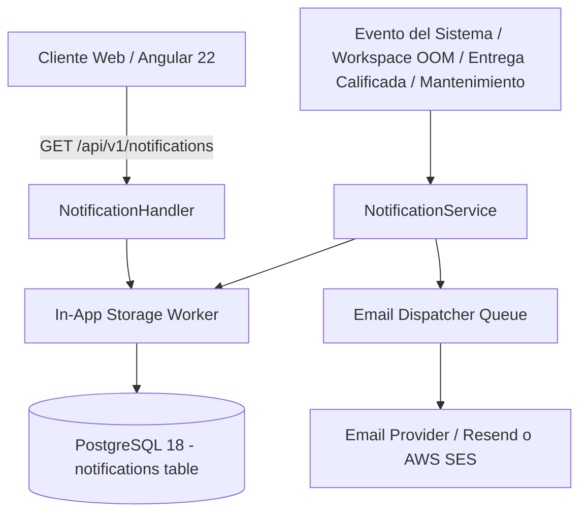

# Diseño Técnico — SLICE 15: Notificaciones Proactivas (In-App & Email)

## 1. Arquitectura de Despacho de Notificaciones

## 2. Componentes del Sistema

### 2.1 Modelo de Notificaciones In-App
- Tabla `notifications` (`id`, `tenant_id`, `recipient_user_id`, `channel`, `severity`, `title`, `message`, `event_type`, `metadata`, `is_read`, `read_at`, `email_sent_at`, `occurrence_count`, `link`, `created_at`).
- Severidades: `info`, `warning`, `error`, `critical`.
- Listado con filtros `severity`, `event_type` y `unread_only`; el total viaja en `X-Total-Count`.
- Marcar como leída de forma individual (`PATCH /api/v1/notifications/{id}/read`) o masiva (`POST /api/v1/notifications/mark-all-read`).
- `link` solo admite rutas internas saneadas; se descartan URLs externas, protocolos y traversal al escribir y al leer.

### 2.2 Consolidación anti-fatiga
- Solo los eventos de infraestructura que lo piden explícitamente (`Consolidate`) se agrupan dentro de una ventana de 30 minutos, incrementando `occurrence_count` y volviendo a marcar el aviso como no leído.
- Calificaciones y recordatorios de vencimiento nunca se consolidan: cada uno conserva su propio aviso.

### 2.3 Eventos que alimentan la campana
- `grade_published`: nota y retroalimentación publicadas.
- `deadline_reminder`: entrega próxima a vencer sin entrega registrada.
- `maintenance_enabled` / `maintenance_disabled`: cambio de modo mantenimiento, incluido el apagado automático por vigencia vencida.
- `backup_created` / `backup_failed`: resultado de respaldos.
- `TEMPLATE_WARMING_COMPLETED`: fin del calentamiento de plantillas.

### 2.4 Frontend
- `core/services/notification.service.ts`: Signals para avisos recientes, página, contador y filtros; sondeo del contador cada 60 segundos y refresco al volver a la pestaña.
- `shared/components/topbar/topbar.component.ts`: campana con contador real, últimos ocho avisos, marcado individual y enlace a la página completa.
- `features/shared/notifications/notifications-page.component.ts`: página compartida en `/student/notifications`, `/teacher/notifications` y `/admin/notifications`, con pestañas, filtro por severidad, paginación y enlaces internos.

### 2.5 Despachador de Correo Electrónico
- Envío asíncrono reservado para eventos de severidad `critical` o `warning` institucional (por ejemplo: anuncio de mantenimiento programado, fallo en backup, credencial de invitación).
- Reglas anti-fatiga: Limitación de tasa máxima (rate-limit) de correos por usuario para evitar saturación de bandejas de entrada.

## 3. Estado del Incremento
- **Backend:** Implementado para el canal in-app (eventos, filtros, consolidación y saneo de enlaces).
- **Frontend:** Implementado (campana y página de avisos en los tres roles).
- **Pendiente:** envío de correo desde el despachador y preferencias por usuario.
