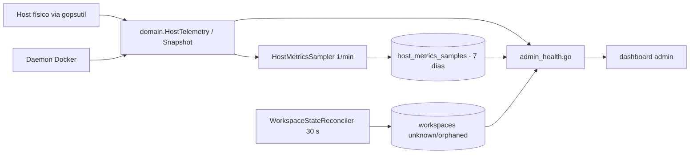

# Diseño Técnico — Slice 17: Telemetría Verdadera del Panel de Salud

## 1. Arquitectura del flujo de telemetría

## 2. Componentes nuevos

| Componente | Responsabilidad |
|-------------|-----------------|
| `domain.HostTelemetry` + `system/host_telemetry.go` + `docker/docker_info.go` | Snapshot del host: RAM, CPU, disco con ruta real, estado del daemon. |
| `domain.EstimateCapacity` (`domain/capacity.go`) | `min(policy, floor(availableMB / ram_per_lab))`, nunca por debajo de running; expone `capacity_basis`. |
| `CountWorkspacesByStatus` (repositorio) | Agregado `GROUP BY status` real, no derivado de una lista de running. |
| `HostMetricsSample` + worker + repositorio | 1 fila/min en `host_metrics_samples`, retención 7 días, poda. |
| `WorkspaceStateReconciler` | Marca `unknown` (daemon caído, retiene cupo) u `orphaned` (contenedor ausente, libera cupo) dentro del ciclo de 30 s del zombie collector. |
| `domain.EvaluateHealth` | `operational / degraded / critical` + 5 códigos estables de `health_reasons`. |

## 3. Contrato del endpoint

`GET /api/v1/admin/metrics/health?window=60m|24h` — ver contrato completo en `docs/API_CONTRACTS.md` (sección Slice 17).

## 4. Reglas operativas

- Estados de workspace nuevos: `workspaces.status` es VARCHAR sin CHECK; no requieren migración de constraint.
- `GetActiveWorkspaces` (cupo) incluye `unknown` y excluye `orphaned`.
- El muestreo escribe bajo el tenant por defecto; la lectura filtra por tenant del request.