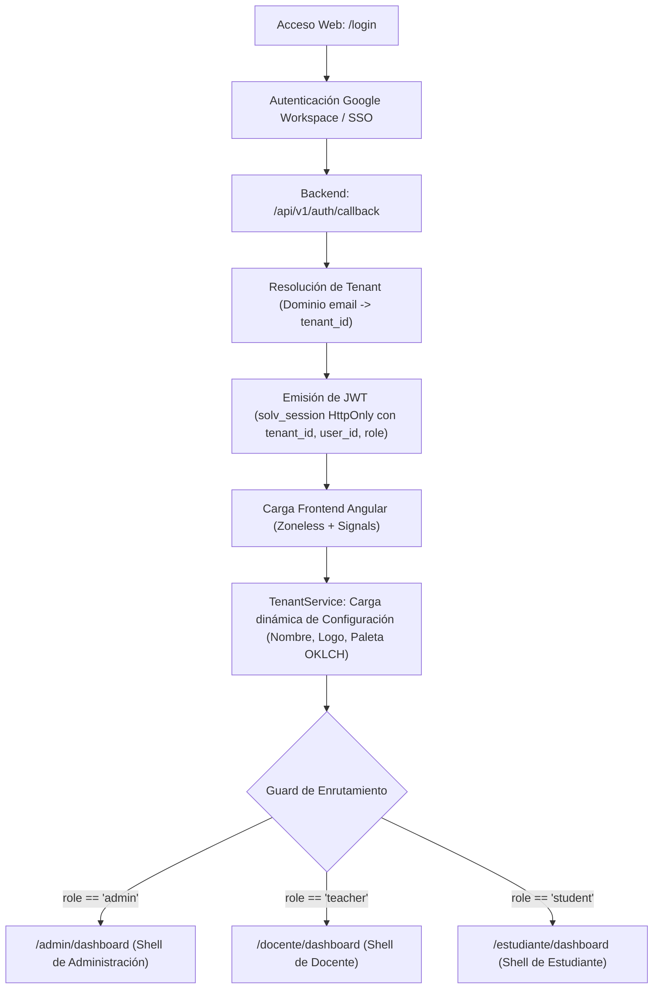

# Mapa Integral de Vistas y Arquitectura de Navegación de SOLV

> **Documento Maestro de Arquitectura de Información (IA)**  
> **Sistema:** SOLV — Plataforma de Orquestación de Laboratorios Virtuales  
> **Alcance:** Multi-tenant Dinámico · Todos los Roles (Admin, Docente, Estudiante) · Contratos de Interfaz  
> **Gobernanza:** SDD / Docs-as-Code / SOLV Design System / Decisión D1–D6  

---

## 1. Arquitectura Global y Resolución Dinámica Multi-Tenant

El sistema opera bajo un esquema **100% Multi-Tenant Dinámico**. No existen dominios, nombres de facultades ni logotipos fijos en el código.

### 1.1. Flujo de Entrada y Derivación por Rol



### 1.2. Principio de Inyección Visual de Tenant
* **Topbar e Identidad:** El componente `solv-topbar` lee de `TenantService.config()` de forma reactiva:
  * Si hay `logo_url`, renderiza la imagen institucional.
  * Si no hay logo o falla la carga, renderiza `brand-shield` con las iniciales calculadas (`tenantInitials()`).
  * Inyecta la variable CSS `--tenant-primary` en formato OKLCH ajustada para contraste WCAG AA.

---

## 2. Árbol General de Navegación

```text
/ (Raíz)
├── /login .............................. Portal institucional de inicio de sesión
│
├── /admin (Rol: Administrador de Institución)
│   ├── /admin/dashboard ................ Salud del servidor, consumo de recursos y contenedores
│   ├── /admin/docentes ................. Gestión del plantel docente e invitaciones
│   ├── /admin/plantillas ............... Catálogo y aprobación de plantillas Docker
│   ├── /admin/configuracion ............ Períodos académicos, marca institucional y servidor
│   └── /admin/auditoria ................ Registro inmutable de eventos y trazabilidad
│
├── /teacher (Rol: Docente)
│   ├── /teacher/dashboard .............. Hoy: canvas de materias y columna de pendientes
│   ├── /teacher/aula ................... Qué pasa ahora en clase: entornos abiertos y telemetría (ancla permanente)
│   ├── /teacher/por-calificar .......... Cola de corrección agrupada por práctica
│   ├── /teacher/cursos/:id ............. Materia: prácticas, entregas, alumnos y libreta
│   ├── /teacher/revision/:submissionId . SpeedGrader: revisión de una entrega
│   ├── /teacher/exercises .............. Banco de ejercicios del docente (catálogo; acción Duplicar a otra materia)
│   ├── /teacher/templates .............. Catálogo de plantillas de entorno
│   ├── /teacher/anti-plagio ............ Redirige a Por calificar (el listado global se retiró)
│   ├── /teacher/cursos/:courseId/practicas/:exerciseId/similitud
│   │                                      Auditoría de similitud en tres columnas (pares, diff y cadencia), con la base restada
│   └── /teacher/configuracion .......... Preferencias de asistencia con IA
│
└── /student (Rol: Estudiante)
    ├── /student ........................ Cuaderno académico (materias, prácticas y entregas)
    ├── /student/aula ................... Aula abierta: práctica de la sesión, horario, presencia y avances
    ├── /student/courses ................ Mis materias
    ├── /student/courses/:courseId ...... Materia: prácticas y entregas
    ├── /student/evaluations ............ Evaluaciones
    ├── /student/history ................ Historial
    └── /student/exercises/:exerciseId .. Práctica: enunciado, juez y entorno IDE acotado a esa práctica

> El laboratorio por materia se retiró: el entorno, el volumen y el avance del aula se acotan a una
> práctica. El alumno abre su IDE desde la práctica, no desde la materia, y el aviso de avance del
> docente llega a esa misma pantalla.
```

---

## 3. Rol Administrador: Fichas Técnicas de Pantallas

### 3.1. Dashboard de Infraestructura y Salud (`/admin/dashboard`)
* **Propósito:** Supervisar la estabilidad del servidor host (CPU, RAM, Disco) y la carga de contenedores en tiempo real.
* **Información que muestra:**
  * 4 Tarjetas KPI de Hardware: Memoria RAM utilizada/total con barra de umbral semántico, Carga media de vCPU, Almacenamiento NVMe (`/var/lib/docker`) y Concurrencia de contenedores (Activos / Hibernados / Límite).
  * Gráfico de Carga Temporal: Consumo de los últimos 60 minutos con línea proyectada de capacidad máxima.
  * Tabla de Contenedores Activos: Alumno, Curso, Imagen Docker base, RAM consumida, TTL restante y estado de red.
* **Acciones Principales:**
  * `[Hibernar Todo]` — Pasa todos los contenedores inactivos a estado hibernado para liberar RAM.
  * `[Detener Contenedor]` — Finaliza una instancia específica que exceda límites de consumo.
  * `[Ver Logs de Docker]` — Abre un panel lateral con salida directa del motor Docker.

### 3.2. Gestión de Docentes e Invitaciones (`/admin/docentes`)
* **Propósito:** Administrar el ciclo de vida del personal docente asignado a la institución.
* **Información que muestra:**
  * Tabla de Docentes: Nombre completo, correo institucional, cursos asignados, último acceso y estado (Activo / Invitación Pendiente / Inactivo).
  * Contador de cupos docentes utilizados vs contratados.
* **Acciones y Disparadores:**
  * `[+ Invitar Profesor]` — Abre Modal de Invitación: solicita correo electrónico institucional; genera token de un solo uso con TTL de 72 horas y envía enlace por correo.
  * `[Reenviar Enlace]` — Renueva la vigencia de una invitación pendiente.
  * `[Revocar Acceso]` — Abre diálogo de confirmación para deshabilitar credenciales del profesor.

### 3.3. Catálogo y Gobernanza de Plantillas Docker (`/admin/plantillas`)
* **Propósito:** Mantener la lista blanca de imágenes Docker seguras que los docentes pueden seleccionar al crear laboratorios.
* **Información que muestra:**
  * Grilla de Plantillas Aprobadas: Nombre del perfil (ej. *Python Data Science*, *C++ Algoritmos*, *PostgreSQL 16*), tag fijado (prohibido `:latest`), límite de RAM por defecto y fecha de validación.
  * Bandeja de Solicitudes Pendientes: Peticiones enviadas por docentes solicitando imágenes nuevas.
* **Acciones y Disparadores:**
  * `[+ Nueva Plantilla]` — Modal para registrar imagen Docker aprobada, asignando cuota base de RAM/CPU y comprobando existencia en registro.
  * `[Revisar Solicitud]` — Abre diálogo de revisión técnica: inspección de capas, vulnerabilidades y aprobación/rechazo con justificación.

### 3.4. Configuración Institucional (`/admin/configuracion`)
* **Propósito:** Control centralizado de parámetros académicos, marca de la institución y políticas del servidor en 3 pestañas:
  * **Pestaña 1 (Períodos Académicos):** Listado de semestres (Activo, Planificado, Archivado). Botón `[+ Nuevo Período]` y acción `[Archivar Período]` (requiere confirmación manual escribiendo el código del semestre; pasa los cursos y laboratorios a modo solo lectura `:ro`).
  * **Pestaña 2 (Marca e Identidad White-Label):** Subida de logotipo institucional, nombre formal de la universidad y selector de color primario en OKLCH con validación automática de contraste WCAG AA (4.5:1). Incluye vista previa en vivo sin recargar la página.
  * **Pestaña 3 (Servidor y Respaldos):** Cuotas de RAM máxima por estudiante, tiempo de inactividad antes de hibernar (por defecto 15 minutos) y panel de respaldos automáticos con checksum SHA-256 y botón `[Generar Respaldo Ahora]`.

### 3.5. Registro de Auditoría (`/admin/auditoria`)
* **Propósito:** Consulta de registros inmutables de seguridad y eventos del sistema.
* **Información que muestra:**
  * Tabla paginada de eventos: Marca de tiempo ISO-8601, Actor (correo o sistema), Acción ejecutada (ej. `AUTH_LOGIN`, `CONTAINER_START`, `PERIOD_ARCHIVE`), Dirección IP y Veredicto/Estado HTTP.
  * Filtros avanzados por rango de fechas, actor y tipo de operación.
* **Acciones:**
  * `[Exportar CSV/JSON]` — Descarga del segmento filtrado para auditorías externas.

---

## 4. Rol Docente: Fichas Técnicas de Pantallas

### 4.1. Hoy (`/teacher/dashboard`)
* **Propósito:** Responder una sola pregunta: qué espera al docente hoy. Especificación completa en [DOCENTE/REDISENO_PANEL_DOCENTE.md](DOCENTE/REDISENO_PANEL_DOCENTE.md) y decisión de composición en [ADR-057](../ARQUITECTURA/ADR/ADR-057-hoy-canvas-de-materias-y-columna-de-pendientes.md). Pantalla construida el 2026-10-30 sobre el resumen del servidor: canvas de materias y columna de pendientes.
* **Información que muestra:**
  * Cabecera con la fecha, el selector de período y `[Abrir aula]`.
  * Franja de sesión, solo con aula abierta: materia, hora de inicio y fin, práctica y presentes sobre inscritos.
  * Canvas de materias: una tarjeta por materia con código, nombre, inscritos, entregas por calificar, alumnos sin entregar, próximo vencimiento y hasta dos acciones. Orden por código, sin reordenar ni personalizar.
  * Columna de pendientes con tres bloques que se ocultan sin contenido: `Aula ahora`, `Vencimientos` (vencidas y próximas, con urgencia y entregas por calificar; hasta cinco, con total declarado) y `Por calificar`.
  * Sin ejecución: ni entornos, ni contenedores, ni telemetría. Esos datos viven en Aula.
* **Contratos:** `GET /api/v1/teacher/overview?period_id=`, refrescado cada 60 segundos. Todas las cifras y el orden los resuelve el servidor; el cliente no suma, no agrupa y no recorta.
* **Estados:** esqueleto al cargar, período sin materias con el selector, sin pendientes con la columna retirada, error de red con reintento que conserva lo cargado.
* **Acciones:**
  * Tarjeta de materia — Navega a `/teacher/cursos/:id`.
  * `[Calificar]` en la tarjeta o en el bloque de la cola — Navega a `/teacher/por-calificar` con `?subject_id=`.
  * `[Abrir aula]` en la tarjeta o en la cabecera — Navega a `/teacher/aula` con `?subject_id=` para abrir la sesión de esa materia.
  * `[Ir al aula]` en la tarjeta o en la franja — Navega a `/teacher/aula` con el tablero de la clase en curso.

### 4.2. Detalle de Curso (`/docente/cursos/:id`)
* **Propósito:** Gestión interna de una materia específica mediante 3 pestañas:
  * **Laboratorios:** Lista cronológica de actividades prácticas con sus fechas límite y estado (Borrador / Publicado / Cerrado).
  * **Estudiantes:** Nómina de alumnos, estado de avance individual y enlaces directos a sus entornos.
  * **Métricas:** Estadísticas agregadas de tiempos de resolución, tasa de éxito y problemas comunes.

### 4.3. Asistente de Creación/Edición de Laboratorio (`/docente/laboratorios/nuevo`)
* **Propósito:** Formulario paso a paso para desplegar una nueva actividad práctica.
* **Flujo en 3 Pasos:**
  * **Paso 1 (Datos Generales):** Título, curso asignado, fechas de apertura y cierre, descripción pedagógica.
  * **Paso 2 (Modalidad Técnica):**
    * *Opción A - Entorno Completo (IDE):* Selección de plantilla Docker del catálogo de la institución, límite de RAM y tiempo de inactividad permitido.
    * *Opción B - Juez Virtual (Algoritmos):* Selección de lenguaje base, tiempo máximo de ejecución por caso de prueba y memoria límite.
  * **Paso 3 (Restricciones y Evaluación):** Carga de casos de prueba (públicos para el estudiante y privados para calificación) y reglas de análisis estático de código (Semgrep).
* **Acciones:**
  * `[Guardar Borrador]` — Guarda los cambios sin hacer visible el laboratorio a los alumnos.
  * `[Publicar a la Clase]` — Habilita el laboratorio en el calendario de los estudiantes.

### 4.4. Aula (`/teacher/aula`)
* **Propósito:** Responder una sola pregunta mientras ocurre la clase: quién está, quién falta y quién se trabó. Con aula abierta muestra el tablero de la sesión; sin aula muestra el formulario de apertura y, si hay entornos encendidos, su telemetría, sin lista de faltantes y sin botón de cerrar.
* **Contratos:** `GET /api/v1/teacher/sessions/open`, `GET /api/v1/teacher/sessions/{id}/board` (refresco cada 5 segundos; también se lee con el aula cerrada para el examen), `POST /api/v1/teacher/sessions`, `PATCH /api/v1/teacher/sessions/{id}/close`, `/freeze`, `/unfreeze`, `/grace`, `POST /api/v1/teacher/sessions/{id}/exam-freeze`, `POST /api/v1/teacher/sessions/{id}/students/{studentID}/unfreeze`, `POST /api/v1/teacher/sessions/{id}/advances`, `GET /api/v1/teacher/sessions/{id}/advances` y `GET /api/v1/teacher/sessions/{id}/history`.
* **Información que muestra (con aula):**
  * Cabecera con materia, hora de apertura y de fin, práctica de la sesión, presentes sobre inscritos, `[Abrir mi IDE]`, `[Emitir avance]`, `[Congelar]` / `[Descongelar]` y `[Cerrar aula]`. Cuando la práctica es un examen, la cabecera lo marca y el botón pasa a `[Cerrar examen]`, con un aviso de que los entornos quedan en solo lectura (ADR-005 §5).
  * Con la clase congelada, un aviso ámbar con la hora de congelación: no se emiten avances nuevos, el editor del alumno sigue igual y el botón de emisión queda deshabilitado.
  * Tras emitir, una línea verde con la práctica emitida y a cuántos alumnos llegó, que se puede cerrar.
  * Marcador: "Todo en orden: N de M entregaron, 0 trabados" o los chips de trabados, sin entregar, sin empezar y salieron.
  * Tabla de alumnos con estado (trabado, sin empezar, salió, entregó, trabajando), hora y veredicto de la entrega, intentos y entorno, con filtros y búsqueda.
  * Avances de esta clase: una fila por emisión con la práctica, la hora, los archivos y cuántos aplicaron, descartaron y quedan pendientes.
  * Historial de esta clase: emisiones, congelaciones, cambios de ventana y decisiones de los alumnos, con nombre, rol, detalle y hora, del más nuevo al más viejo. El alumno no lo ve.
  * Telemetría acotada a los entornos de la materia de la sesión.
* **Información que muestra (examen cerrado):** un panel con cuántos entornos quedaron en solo lectura, el resultado del cierre (`frozen`, `skipped`, `failed`) y la lista de alumnos con entorno, cada uno con su estado y la acción de reabrir. Si algún volumen no se pudo cerrar, el panel lo dice y permite reintentar.
* **Información que muestra (sin aula):** formulario de apertura —materia y práctica publicada opcional—, la ventana de disponibilidad del aula cerrada —hasta cuándo se pueden aplicar sus avances, con el campo libre de minutos, la fecha límite y el cierre manual—, el historial de la última clase cerrada mientras la pestaña siga abierta y los entornos abiertos ahora de todas las materias.
* **Acciones:**
  * `[Abrir mi IDE]` — Abre el entorno de la práctica de la sesión en una pestaña nueva, sin salir de la supervisión y sin pasar por la ficha de la materia. Sin práctica en el aula queda deshabilitado y explica el motivo; mientras abre muestra el progreso y, si falla, cierra la pestaña y deja el mensaje del servidor bajo la cabecera. No hay acción de detener: el contenedor lo apaga el QoS por inactividad (ADR-011).
  * `[Emitir avance]` — Abre el modal de emisión: práctica publicada de la materia (la del aula, ya elegida) y alcance: toda la clase o alumnos elegidos entre quienes pasaron por el aula. Emitir guarda el código del entorno de clase como snapshot; el alumno recibe esa versión aunque el docente siga editando.
  * `[Congelar]` / `[Descongelar]` — Corta o restablece las emisiones nuevas sin tocar el trabajo del alumno. Congelar dos veces conserva la hora de la primera.
  * Ventana de disponibilidad — Al cerrar el aula quedan 30 minutos automáticos. Con el aula cerrada, el bloque ofrece `[Sumar]` sobre un campo libre de 1 a 480 minutos, `[Fijar]` una fecha límite para una tarea y `[Cerrar ventana ahora]`. Se rige por [ADR-058 §4](../ARQUITECTURA/ADR/ADR-058-avance-voluntario-del-docente-en-aula.md).
  * `[Abrir aula]` — Abre la sesión de una materia con una duración (por defecto 1 h 30); una segunda aula abierta en la misma materia responde conflicto.
  * `[Cerrar aula]` — Cierra la sesión; es idempotente y corta la presencia de esa clase.
  * `[Cerrar examen]` — El mismo cierre cuando la práctica es un examen: además deja el volumen de cada alumno en solo lectura y devuelve el conteo. Un fallo parcial se puede reintentar con `[Reintentar congelamiento]` sin reabrir la clase.
  * `[Reabrir]` — Excepción individual sobre un alumno del examen cerrado. Pide un motivo obligatorio, lo deja en el historial y devuelve la escritura solo a ese volumen.
  * Cierre por vencimiento — al llegar a `ends_at` el aula se cierra sola en la siguiente lectura o apertura, sin proceso periódico. La pantalla deja el modo en vivo y avisa a qué hora se cerró; la materia queda libre para abrir otra aula.
  * `[Ver detalle]` — Abre el estado de una emisión: cada alumno con su estado (aplicó, descartó, pendiente, venció, falló) y la hora en que decidió. La lista se refresca al emitir y con `[Actualizar]`, no en el bucle de 5 segundos.
  * Historial de esta clase — Lo que pasó en el aula, con el actor y la hora. Se refresca al abrir la clase, al emitir, al congelar o descongelar, al ajustar la ventana y con `[Actualizar]`; las decisiones de los alumnos aparecen al pedir la actualización. Solo lo ve el docente o el administrador.
  * `[Consola]` — Abre la terminal de sombra del entorno del alumno, con la sesión auditada.
* **Presencia:** la emite el cliente del alumno cada minuto sobre el aula abierta de sus materias (`GET /api/v1/student/sessions/active`, `POST /api/v1/student/sessions/{id}/heartbeat`). Una señal de más de 120 segundos no cuenta.
* **Fuera de alcance:** reiniciar contenedores y ajustar recursos son acciones del administrador; el docente no opera infraestructura. El modo proyección, la agrupación de excepciones por causa y la actualización por SSE están especificados y pendientes.

### 4.5. Entorno de Clase (`/teacher/entorno`) — retirada
* **Estado:** la pantalla se retiró. El entorno del docente se abre desde la ficha de cada práctica con `[Abrir IDE]`, acotado a esa práctica y no a la materia (ADR-059). `/teacher/entorno` redirige a Hoy para no romper marcadores ni enlaces anteriores.
* **Motivo:** un curso no tiene un entorno monolítico; cada práctica trae su plantilla y su stack. El código que se emite en el aula sale del entorno de la práctica de la sesión (ADR-058 §5).
* **Contratos que siguen vivos:** `POST /api/v1/environments/start` con `subject_id` y `exercise_id` (obligatorios) para abrir o reanudar un entorno de práctica. La lectura por materia se retiró con el modelo anterior. La ficha usa `POST /api/v1/teacher/courses/{courseId}/exercises/{exerciseId}/ide`.
* **Dónde vive ahora cada acción:** abrir o reanudar el entorno, en la ficha de la práctica y, durante la clase, con `[Abrir mi IDE]` en el aula; emitir el avance, congelar la clase y extender la ventana, en el aula.
* **Fuera de alcance:** los reinicios y los recursos son acciones del administrador.

### 4.6. Juez Virtual — Auditoría y Calificación (`/docente/juez`)
* **Propósito:** Banco de ejercicios algorítmicos y revisión manual de código entregado.
* **Información que muestra:**
  * Banco de Problemas del profesor clasificados por dificultad y etiquetas.
  * Cola de Envíos Pendientes de Calificación.
* **Pantalla de Auditoría de Código:**
  * Editor Monaco en modo solo lectura (`:ro`) con la solución enviada por el alumno.
  * Detalle de ejecución de casos de prueba (tiempos en milisegundos y memoria utilizada).
  * Resumen de reglas Semgrep aplicadas (ej. verificación de no uso de librerías prohibidas).
  * Campo para retroalimentación cualitativa y botón `[Confirmar Calificación]`.

---

## 5. Rol Estudiante: Fichas Técnicas de Pantallas

### 5.1. Inicio del Estudiante (`/student`)
* **Propósito:** Responde al entrar qué clase está abierta, qué se entrega pronto y cómo va en sus materias. No es un tablero configurable ni un panel de contenedores.
* **Información que muestra:**
  * Saludo por franja horaria y un resumen de una línea (clase abierta, entregas próximas o ausencia de ellas). Un fallo al leer las entregas no se dibuja como "al día".
  * **Aula ahora:** materia y código, estado de la sesión, práctica del aula, horario y presencia (`present` de `enrolled`).
  * **Próximas entregas:** hasta cuatro, con materia y fecha límite.
  * **Tus materias:** código, nombre, prácticas completadas sobre el total y barra de avance, con el porcentaje global del semestre.
  * **Últimas entregas:** tres, con veredicto y fecha compacta.
* **Acciones:**
  * `[Entrar al aula]` — Va a `/student/aula`; si hay más clases, un enlace indica cuántas hay.
  * `[Ver mis prácticas]` — `/student/courses` cuando no hay clase abierta.
  * `[Mis entregas]` y `Historial` — `/student/history`.
  * Cada entrega enlaza a `/student/exercises/:exerciseId`; cada materia, a su mapa curricular.
* **Lo que no hace:** no abre ni reanuda entornos (son de la práctica, ADR-059) y no lista avances del docente, que viven en el aula y en la práctica.
* **Presencia en el aula:** el layout del estudiante consulta cada minuto las aulas abiertas (`GET /api/v1/student/sessions/active`) y emite su señal (`POST /api/v1/student/sessions/{id}/heartbeat`) mientras la pestaña está visible. Esa señal es la que el docente ve como "dentro" en `/teacher/aula`; se corta al cerrarse el aula o al dejar de estar matriculado.

### 5.2. Aula del Estudiante (`/student/aula`)
* **Propósito:** Unir la clase en vivo con la práctica que el docente abrió: qué materia, qué práctica, en qué horario y qué código compartió.
* **Información que muestra:**
  * Materia con su código y estado del aula (abierta, congelada, cerrada).
  * Práctica de la sesión (`exercise_title`) o el aviso de que el aula no tiene práctica asociada.
  * Horario de la clase y presencia (`present` de `enrolled` en el aula).
  * Avances pendientes **de esa sesión**: cuántos archivos trae y cuándo se emitió.
* **Acciones:**
  * `[Abrir práctica]` — Va a `/student/exercises/:exerciseId`, el entorno de la práctica del aula.
  * `[Revisar y aplicar]` — Abre el mismo modal de confirmación de la práctica, con los archivos que se reemplazan y los que se agregan.
  * `[Actualizar]` — Relee el aula y los avisos sin esperar al ciclo de un minuto.
* **Estados vacíos:** sin aula abierta, dice que no hay clase y ofrece `[Ver mis prácticas]`. Un aula sin práctica se muestra sin botón de avance, porque en ese estado el docente tampoco puede emitir.

### 5.3. Práctica (`/student/exercises/:exerciseId`)
* **Propósito:** Resolver la práctica con su enunciado, su juez y su entorno IDE acotado a esa práctica.
* **Componentes de la Pantalla:**
  * **Topbar de la práctica:** materia, título de la práctica, tiempo restante de la sesión y `[Abrir entorno]` (levanta o reanuda el contenedor de esa práctica).
  * **Franja de avance del docente:** una por aviso pendiente, sobre el editor. Dice que el docente emitió un avance, cuántos archivos trae y que puede tardar hasta un minuto en aparecer (la consulta es cada minuto, ADR-058 §8). Con `[Ver archivos]` y `[Descartar]`.
  * **Confirmación del avance:** modal con dos listas, los archivos que se reemplazan —en ámbar, con el aviso de que la versión actual queda respaldada— y los que se agregan, y `[Aplicar avance]`. Después informa cuántos archivos se escribieron y dónde quedó la copia anterior.
  * **Aviso de examen cerrado:** con el estado `frozen`, el área del editor se reemplaza por el motivo y la hora del cierre, sin `[Iniciar entorno]` ni enlace al editor (ADR-005 §5).
  * **Área Central Completa:** iframe seguro de OpenVSCode que se comunica mediante `window.postMessage`, sin exponer identificadores de contenedor, puertos ni consumo interno.

### 5.4. Juez Virtual — Resolución y Evaluación (`/student/exercises/:exerciseId`)
* **Propósito:** Resolución de problemas de lógica y algoritmos con evaluación formativa instantánea.
* **Componentes de la Pantalla:**
  * **Panel Izquierdo:** Consigna del problema, ejemplos de entrada/salida y restricciones de diseño pedagógico (lo que está permitido o prohibido usar).
  * **Panel Superior Derecho:** Monaco Editor interactivo con resaltado de sintaxis y autocompletado para el lenguaje configurado.
  * **Panel Inferior Derecho (Consola y Veredictos):**
    * Botón `[Ejecutar Pruebas]` — Corre el código frente a los casos de prueba visibles.
    * Botón `[Enviar Solución]` — Ejecuta la validación completa (casos privados + análisis estático Semgrep).
    * Indicador de Veredicto Semántico:
      * `AC` (Aceptado): Verde.
      * `WA` (Respuesta Incorrecta): Rojo.
      * `TLE` (Tiempo Límite Excedido): Ámbar.
      * `RE` (Error de Ejecución): Naranja.
      * `AST_BLOCKED` (Restricción de Código Violada): Rojo intenso con explicación constructiva de la regla infringida.

---

## 6. Matriz de Estados Globales del Sistema

| Estado Técnico | Color Semántico | Significado para el Usuario |
| :--- | :--- | :--- |
| `running` | Verde éxito | Contenedor o servicio funcionando con normalidad |
| `pending` | Amarillo advertencia | Contenedor levantando, comprobación en cola o invitación enviada |
| `hibernated` | Gris neutro | Contenedor pausado en disco para preservar recursos |
| `frozen` | Gris neutro | Examen cerrado: el volumen quedó en solo lectura y el trabajo se conserva |
| `failed` / `oom_killed` | Rojo error | Proceso finalizado por error o falta de memoria |
| `AC` | Verde éxito | Solución aprobada en todos los casos |
| `WA` | Rojo error | La salida generada no coincide con la esperada |
| `TLE` | Ámbar advertencia | El algoritmo superó el tiempo máximo asignado |
| `RE` | Naranja error | Error fatal durante la ejecución del programa |
| `AST_BLOCKED` | Rojo intenso | El código contiene estructuras o funciones no permitidas por la cátedra |
