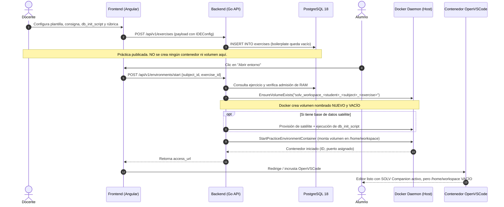
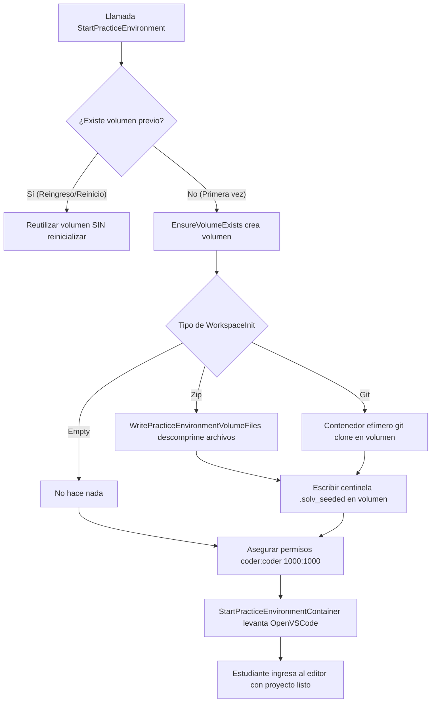

# Auditoría funcional y propuesta de diseño: Inicialización de espacios de trabajo en SOLV (`IDE_PERSISTENTE`)

> [!IMPORTANT]
> **Carácter del documento**: Este informe es una auditoría técnica y funcional de solo lectura. No modifica bases de datos, no añade migraciones ni altera código productivo. Su objetivo es diagnosticar el flujo actual con evidencias exactas del repositorio y proponer un diseño arquitectónico riguroso para la preparación inicial de proyectos en laboratorios de desarrollo.

---

## A. Estado funcional actual

### 1. La experiencia del Docente
Cuando un docente crea un laboratorio bajo la modalidad de **Entorno de Desarrollo (`IDE_PERSISTENTE`)**, accede al formulario guiado en el frontend ([`step-ide-environment.component.ts`](file:///home/alrivera/SOLV_PG/frontend/src/app/features/teacher/exercise-editor/steps/step-ide-environment/step-ide-environment.component.ts#L48-L100)). En esa pantalla dispone de:
1. **Entorno de Trabajo**: Selector visual de plantillas homologadas por administración ([`ide-template-selector.component.ts`](file:///home/alrivera/SOLV_PG/frontend/src/app/features/teacher/exercise-editor/steps/step-ide-environment/components/ide-template-selector/ide-template-selector.component.ts)).
2. **Base de Datos Satélite**: Editor de script DDL/DML de inicialización (`db_init_script`), visible únicamente si la plantilla declara un motor de persistencia asociado ([`ide-db-init-script.component.ts`](file:///home/alrivera/SOLV_PG/frontend/src/app/features/teacher/exercise-editor/steps/step-ide-environment/components/ide-db-init-script/ide-db-init-script.component.ts)).
3. **Consigna Pedagógica**: Editor de texto en Markdown para las instrucciones del laboratorio ([`statement-editor.component.ts`](file:///home/alrivera/SOLV_PG/frontend/src/app/features/teacher/exercise-editor/steps/step-identity/statement-editor.component.ts)).
4. **Parámetros de Entrega**: Configuración de fecha límite, reentrega permitida y checkpoints automáticos ([`ide-delivery-config.component.ts`](file:///home/alrivera/SOLV_PG/frontend/src/app/features/teacher/exercise-editor/steps/step-ide-environment/components/ide-delivery-config/ide-delivery-config.component.ts)).
5. **Rúbrica de Evaluación**: Diseñador de criterios y niveles ponderados para calificar cualitativamente el proyecto ([`ide-rubric-editor.component.ts`](file:///home/alrivera/SOLV_PG/frontend/src/app/features/teacher/exercise-editor/steps/step-ide-environment/components/ide-rubric-editor/ide-rubric-editor.component.ts)).
6. **Configuración de Previsualización (Preview)**: Comando de arranque (`app_run_command`) y puerto TCP (`app_port`) para que el SpeedGrader pueda levantar la app en vivo al corregir ([`ide-preview-config.component.ts`](file:///home/alrivera/SOLV_PG/frontend/src/app/features/teacher/exercise-editor/steps/step-ide-environment/components/ide-preview-config/ide-preview-config.component.ts)).

**Lo que el docente NO puede hacer**: No existe ningún control, botón ni campo que le permita proveer archivos de código inicial, subir un archivo comprimido, indicar un repositorio de inicio o seleccionar un esqueleto de proyecto.

### 2. La experiencia del Estudiante
Cuando el estudiante hace clic en «Abrir entorno» desde su panel de prácticas:
1. Se abre **OpenVSCode Server a pantalla completa**.
2. La extensión oficial **SOLV Companion** ([`tools/solv-companion/README.md`](file:///home/alrivera/SOLV_PG/tools/solv-companion/README.md)) le presenta en el panel lateral:
   - Materia, docente y título de la práctica.
   - Consigna pedagógica completa en Markdown.
   - La rúbrica oficial adaptada al propósito de la clase (`Rúbrica de práctica` o `Rúbrica de evaluación`).
   - Comentarios previos del docente si se trata de una reentrega.
   - Botón directo en la barra de estado para entregar el proyecto (`Entregar Práctica` o `Entregar Examen`).
3. El explorador de archivos de VS Code se abre en la carpeta `/home/workspace`.
4. **El problema visible**: Esa carpeta está **totalmente vacía**. El estudiante tiene en la terminal las herramientas instaladas (Node.js, Angular CLI, Python, Go, según la plantilla), pero debe iniciar su proyecto manualmente o esperar a que el docente dicte las instrucciones de inicialización.

---

## B. Recorrido completo del laboratorio (Trace end-to-end)

El siguiente diagrama ilustra el flujo real desde la creación hasta el ingreso del alumno:



### Dónde surge el problema (Evidencias técnicas):
1. **Frontend Payload**: En [`exercise-editor.store.ts#L963-L971`](file:///home/alrivera/SOLV_PG/frontend/src/app/features/teacher/exercise-editor/exercise-editor.store.ts#L963-L971), el método `buildPayload()` asigna `boilerplate: this.boilerplate()`. Dado que para `IDE_PERSISTENTE` la vista no expone ningún editor de código base, el valor enviado es `""`.
2. **Creación del Volumen**: En [`practice_environment_service.go#L577-L581`](file:///home/alrivera/SOLV_PG/backend/internal/core/services/practice_environment_service.go#L577-L581), el backend ejecuta:
   ```go
   if err := s.docker.EnsureVolumeExists(ctx, volumeName); err != nil { ... }
   ```
   Esta llamada crea un volumen Docker estándar. Si no existía, el sistema de archivos del volumen está vacío (`0 bytes`).
3. **Omisión de script de arranque en OpenVSCode**: En [`docker_container.go#L164-L179`](file:///home/alrivera/SOLV_PG/backend/internal/infrastructure/docker/docker_container.go#L164-L179), la función `imageShipsOpenVSCode` detecta que la imagen contiene `openvscode-server` y pasa como `Cmd` directo los parámetros del servidor (`--without-connection-token --host 0.0.0.0 --port 3000 --default-folder /home/workspace`). La variable `SOLV_SETUP_SCRIPT` **no es ejecutada por el contenedor** en imágenes derivadas de OpenVSCode; solo se ejecuta en la rama de `pureRuntimePracticeEnvironmentCmd` pensada para runtimes sin editor web integrado.
4. **Persistencia en reinicios**: En [`practice_environment_service.go#L477-L516`](file:///home/alrivera/SOLV_PG/backend/internal/core/services/practice_environment_service.go#L477-L516), el método `GetByStudentSubjectExercise` detecta si el estudiante ya tiene un entorno. Si el contenedor se apagó, se reactiva con el **mismo volumen nombrado** (`VolumeName()`). Esto preserva el código que el alumno haya creado mientras el volumen no sea destruido.

---

## C. Funcionalidades existentes aprovechables

SOLV cuenta con piezas de ingeniería de alto nivel que resuelven prácticamente todo el plumbing técnico necesario. No se requiere reinventar la rueda:

| Mecanismo existente | Ubicación en el repositorio | Utilidad para el Seeding de Proyectos |
| :--- | :--- | :--- |
| **`WritePracticeEnvironmentVolumeFiles`** | [`docker_practice_environment_volume.go#L131-L176`](file:///home/alrivera/SOLV_PG/backend/internal/infrastructure/docker/docker_practice_environment_volume.go#L131-L176) | **Inyector atómico de archivos**: Usa una imagen efímera (`alpine:3.20`), monta el volumen en `/environment`, descomprime un tar en memoria y preserva permisos `uid: 1000, gid: 1000` (`coder:coder`). Ya está probado y listo para usarse. |
| **`ParseProjectSnapshot`** | [`project_snapshot.go#L47-L98`](file:///home/alrivera/SOLV_PG/backend/internal/core/domain/project_snapshot.go#L47-L98) | **Formato multiarchivo canónico**: Permite empaquetar y desempaquetar múltiples archivos con cabeceras deterministas (`# === FILE: <path> ===`). Es el estándar del SpeedGrader y del diff docente. |
| **`base_files` en SpeedGrader** | [`teacher_grading_repository.go#L236`](file:///home/alrivera/SOLV_PG/backend/internal/infrastructure/storage/postgres/teacher_grading_repository.go#L236) | **Diff automático contra código base**: El SpeedGrader ya tiene programada la lógica para restar el código base del ejercicio si `exercises.boilerplate` contiene un snapshot de proyecto. |
| **Plagiarism Engine Base Subtraction** | [`plagiarism_engine.go#L476`](file:///home/alrivera/SOLV_PG/backend/internal/core/services/plagiarism_engine.go#L476) | **Filtro de falsos positivos**: El motor de similitud (Jaccard + AST) ya descuenta automáticamente los tokens del código inicial provisto por la cátedra para no marcar coincidencias artificiales entre estudiantes. |
| **Mecanismo de Avances en vivo** | [`class_advance_apply.go`](file:///home/alrivera/SOLV_PG/backend/internal/core/services/class_advance_apply.go) | **Control de sobrescritura**: Ya contiene la lógica para manejar versiones previas (`.solv_backups/`), detectar archivos modificados vs nuevos y evitar corrupciones. |

---

## D. Matriz comparativa de alternativas

Analizamos las 5 alternativas de preparación del espacio de trabajo solicitadas:

| Criterio | A: Espacio Vacío | B: Archivos / ZIP del Docente | C: Repositorio Git Inicial | D: Scaffolding en Caliente (`ng new`, etc.) | E: Catálogo de Starters Reutilizables |
| :--- | :--- | :--- | :--- | :--- | :--- |
| **Experiencia Docente** | Nula (0 esfuerzo). | Simple: arrastra un archivo ZIP o define archivos clave. | Media: provee URL, rama y gestiona acceso si es privado. | Media: tilda checkboxes de opciones del CLI. | Óptima: selecciona "NestJS Starter" de un combo. |
| **Experiencia Estudiante** | Debe hacer todo el setup a mano en consola. | Inmediata: abre el editor y el proyecto ya está listo. | Inmediata si el clone fue exitoso. | Muy lenta: espera 2-5 min de descarga en el primer arranque. | Inmediata: proyecto estructurado al entrar. |
| **Complejidad Técnica** | Nula (es el comportamiento actual). | **Baja**: reusa `WritePracticeEnvironmentVolumeFiles`. | **Alta**: manejo de credenciales privadas, conectividad y red. | **Crítica**: alto consumo de CPU, RAM y red en concurrencia. | **Baja/Media**: variante de B almacenada en catálogo común. |
| **Seguridad** | Alta (volumen vacío). | Media/Alta: requiere mitigar *Zip Slip* y validar cuotas. | Riesgo: fuga de tokens Git o inyección de comandos en URLs. | Riesgo: ejecución de scripts arbitrarios en post-install de npm. | Alta: paquetes auditados institucionalmente. |
| **Flexibilidad** | Total para el alumno, nula para el docente. | **Máxima**: cualquier lenguaje, framework o estructura. | Alta: proyectos versionados externamente. | Baja: atado a los CLIs soportados por la plataforma. | Media: limitada a lo que ofrezca el catálogo. |
| **Reproducibilidad** | Baja (cada alumno puede estructurar distinto). | **100% determinista** (idéntico byte a byte para todos). | Variable (si el repo cambia en `main`, cambia la base). | Variable (los paquetes npm pueden resolver versiones menores). | **100% determinista**. |
| **Impacto en Recursos** | 0 overhead. | Muy bajo (extracción local de pocos megabytes). | Dependiente del tamaño del historial `.git`. | **Inviable en masa**: 30 alumnos concurrentes harían 30 `npm install`. | Muy bajo. |

### Veredicto comparativo:
- La **Alternativa D (Scaffolding en caliente)** queda **totalmente desaconsejada** para el momento en que el alumno ingresa: ejecutar `ng new` o `nest new` en tiempo real descarga cientos de megabytes de dependencias, satura el ancho de banda del servidor host y viola las políticas de admisión rápida de SOLV.
- La **Alternativa B (Archivos / ZIP)** es la opción arquitectónica **más sólida, segura y flexible**: no depende de conexiones externas, aprovecha el inyector atómico que ya existe y garantiza que todos los estudiantes reciban el mismo código exacto.
- La **Alternativa C (Git)** tiene valor académico para prácticas que enseñan flujo Git, pero introduce complejidad en credenciales privadas y reproducibilidad.
- La **Alternativa E (Plantillas de catálogo)** es una evolución natural de B orientada a la comodidad del docente.

---

## E. Propuesta de experiencia de usuario (UX Docente y Estudiante)

### 1. En el Editor del Docente (`step-ide-environment`)
Se propone incorporar una nueva sección modular entre la **Consigna Pedagógica** y la **Base de Datos Satélite**, denominada **«Espacio de Trabajo Inicial»**.

#### Interfaz progresiva y no invasiva:
El docente encuentra un selector por pestañas o tarjetas con 3 opciones claras:

```
[ Espacio de Trabajo Inicial ]
-----------------------------------------------------------------------------
(•) Espacio vacío       ( ) Archivos de proyecto (ZIP)       ( ) Repositorio Git
-----------------------------------------------------------------------------
El estudiante iniciará con un directorio de trabajo en blanco (/home/workspace).
Ideal para enseñar fundamentos de programación, uso de la terminal o Git.
```

#### Si el docente elige «Archivos de proyecto (ZIP)»:
1. **Zona de carga (Dropzone)**: Permite arrastrar un archivo `.zip` (máximo recomendado: 15 MB).
2. **Filtro de higiene automático**: El sistema analiza el ZIP en el navegador antes de subirlo y advierte:
   - *«Detectamos carpetas pesadas (`node_modules/`, `.git/`, `.venv/`). Serán excluidas automáticamente para optimizar el rendimiento del laboratorio»*.
3. **Visor de árbol de archivos preliminar**: Muestra el listado de archivos que se extraerán para que el docente verifique visualmente la estructura (ej. `src/app.controller.ts`, `package.json`, etc.).
4. **Archivo principal / punto de entrada**: Campo opcional para indicar qué archivo debería abrirse por defecto en VS Code (ej. `src/main.ts`).

#### Si el docente elige «Repositorio Git»:
1. Campo de URL del repositorio (HTTPS público).
2. Campo de **Rama o Tag de referencia** (ej. `v1.0.0` o `clase-03`).
3. Botón de **«Verificar y congelar commit»**: El backend consulta el HEAD de esa rama y registra el commit hash específico (evitando que cambios posteriores en GitHub rompan laboratorios pasados).

---

### 2. Escenarios universitarios reales

```mermaid
flowchart TD
    subgraph Escenario1["1. Algoritmos y Estructuras (1er Año)"]
        E1[Docente elige: Espacio Vacío] --> S1[Alumno entra a /home/workspace vacío]
        S1 --> T1[Crea main.c con gcc desde la terminal]
    end

    subgraph Escenario2["2. Arquitectura de Software (3er Año)"]
        E2[Docente sube: backend-skeleton.zip] --> S2[Alumno entra y ve módulos auth, users y core]
        S2 --> T2[Completa los servicios en blanco solicitados]
    end

    subgraph Escenario3["3. Bases de Datos Avanzadas"]
        E3[Docente configura: db_init_script + starter app] --> S3[Base satélite inicializada con DDL]
        S3 --> T3[App Node/Go con conexión ya testeada en .env]
    end
```



---

## F. Propuesta de arquitectura conceptual

### 1. El modelo de datos (Extensión natural del dominio)
Sin alterar tablas de evaluación ni contratos del juez, la entidad `ExerciseConfig` de `IDEConfig` ([`exercise.go#L216-L225`](file:///home/alrivera/SOLV_PG/backend/internal/core/domain/exercise.go#L216-L225)) puede incorporar de manera limpia la especificación de inicialización:

```go
type WorkspaceInitType string

const (
    WorkspaceInitEmpty  WorkspaceInitType = "empty"  // Predeterminado
    WorkspaceInitZip    WorkspaceInitType = "zip"    // Archivos provistos por docente
    WorkspaceInitGit    WorkspaceInitType = "git"    // Clonación de repositorio
)

type WorkspaceInitConfig struct {
    Type          WorkspaceInitType `json:"type"`
    ZipAssetID    string            `json:"zip_asset_id,omitempty"`
    GitURL        string            `json:"git_url,omitempty"`
    GitRef        string            `json:"git_ref,omitempty"`        // branch o tag
    GitCommitHash string            `json:"git_commit_hash,omitempty"` // commit fijado
    DefaultFile   string            `json:"default_file,omitempty"`   // archivo a enfocar
}
```

### 2. Flujo de Inicialización Just-In-Time (JIT) en el Ciclo de Vida
La preparación del espacio de trabajo debe ocurrir en el backend dentro de `StartPracticeEnvironmentForExercise` ([`practice_environment_service.go`](file:///home/alrivera/SOLV_PG/backend/internal/core/services/practice_environment_service.go#L577)), justo después de `EnsureVolumeExists` y **antes** de arrancar el contenedor de OpenVSCode Server:



#### Reglas inquebrantables de seguridad y aislamiento:
1. **Idempotencia mediante centinela**: El volumen debe contener un archivo de control (`.solv_seeded`). Si el alumno recarga la página o se reinicia el servidor, el backend detecta el centinela y **nunca vuelve a inicializar**, garantizando que el trabajo del alumno jamás sea pisado.
2. **Mitigación de Zip Slip**: La descompresión en el backend debe validar estrictamente que ninguna ruta de archivo contenga `..` ni resuelva fuera de la raíz de `/home/workspace`.
3. **Límite de cuota preventiva**: El descompresor debe validar un tamaño máximo de descompresión (ej. 50 MB de código) para proteger el almacenamiento del servidor ASUS frente a ataques de compresión (*zip bombs*).

---

## G. Integración con los mecanismos existentes de SOLV

Es fundamental ratificar que esta solución se acopla armoniosamente con todo lo construido:

1. **Con SOLV Companion**: La extensión no requiere modificaciones de fondo. Al arrancar el editor, encontrará el proyecto ya desplegado en el disco y mostrará la consigna y la rúbrica tal como lo hace hoy.
2. **Con los Avances de Clase (`Class Advances`)**: Se integran de forma natural. Los avances de clase operan sobre archivos diferenciales. Si el estudiante ya tiene un proyecto base inicializado, el sistema de avances simplemente detectará qué archivos modificó el docente en vivo respecto a ese proyecto base.
3. **Con SpeedGrader y Diff**: Esta es la mayor ganancia. Al quedar los archivos iniciales registrados en el ejercicio, el SpeedGrader podrá alimentar automáticamente `base_files` en [`teacher_grading_repository.go#L236`](file:///home/alrivera/SOLV_PG/backend/internal/infrastructure/storage/postgres/teacher_grading_repository.go#L236). El docente verá en verde las adiciones del alumno y en rojo las modificaciones sobre el proyecto base original.
4. **Con el Preview Efímero (`Review Environment`)**: El docente ya configura `app_run_command` y `app_port`. Si el proyecto base ya trae la estructura y dependencias estándar (ej. `npm start`), el preview levantará la app de forma mucho más confiable que si el alumno tuvo que adivinar cómo estructurar el proyecto.

---

## H. Recomendación de alcance inicial (Fase 1 vs Futuras)

Para entregar valor inmediato minimizando el riesgo operativo, se recomienda dividir la iniciativa en dos fases:

### Fase 1: MVP de Alto Impacto (Recomendado)
- **Alcance**:
  - Soporte de **Espacio Vacío** (predeterminado actual).
  - Soporte de **Archivos iniciales vía ZIP provisto por el docente**.
  - Inyección JIT en el volumen mediante `WritePracticeEnvironmentVolumeFiles`.
  - Mecanismo centinela anti-sobrescritura (`.solv_seeded`).
  - Validación de seguridad (Zip Slip y cuotas de descompresión).
- **Justificación**: Cubre más del 90% de las necesidades pedagógicas de las cátedras universitarias (proyectos incompletos, esqueletos, laboratorios guiados) sin depender de redes externas ni gestión de credenciales complejas.

### Fase 2: Conectividad y Ecosistema (Posterior)
- **Alcance**:
  - Clonación de repositorios Git públicos con fijación determinista de commit SHA.
  - Catálogo de Starters preconfigurados (NestJS básico, Angular standalone, FastAPI).
  - Configuración de archivo enfocado por defecto al abrir VS Code.

---

## I. Decisiones pendientes de producto

Antes de iniciar cualquier implementación técnica, es necesario alinear las siguientes decisiones de negocio/producto:

1. **Gestión de dependencias pesadas (`node_modules`, `.venv`)**:
   - *¿Cómo se manejarán las dependencias?* La recomendación arquitectónica es que las imágenes Docker del catálogo ya traigan las herramientas globales y los módulos comunes preinstalados, o bien que el estudiante ejecute la instalación en su terminal, evitando almacenar cientos de megabytes de dependencias en el ZIP del docente.
2. **Límite de tamaño para el archivo ZIP del docente**:
   - Definir el umbral máximo de subida (recomendado: 15 MB comprimido, hasta 60 MB expandido).
3. **Almacenamiento de los artefactos del docente**:
   - Definir si los archivos iniciales del ejercicio se almacenan como blobs en el filesystem del servidor backend (`uploads/exercises/`) o si se serializan en el catálogo de PostgreSQL aprovechando el formato snapshot ya existente en SOLV.
