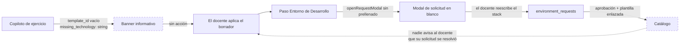

# Auditoría funcional y propuesta de diseño: entorno faltante en el Copiloto de ejercicios (`missing_technology`)

> [!IMPORTANT]
> **Carácter del documento**: informe de solo lectura. No modifica código productivo, ni esquema, ni migraciones. Diagnostica el circuito que se abre cuando el Copiloto de IA no encuentra un entorno homologado y propone el diseño para conectarlo con la solicitud de entorno que ya existe.

---

## A. Estado funcional actual

### 1. Qué devuelve la IA cuando el catálogo no cubre el stack

El Copiloto de ejercicios pide al modelo un JSON con `title`, `description`, `difficulty`, `language`, `template_id`, `missing_technology` y `rubric_criteria` ([`ai_copilot_service.go:864-876`](backend/internal/core/services/ai_copilot_service.go#L864-L876)), y el dominio lo expone como `MissingTechnology` ([`ai_copilot.go:124`](backend/internal/core/domain/ai_copilot.go#L124)).

La instrucción del prompt es explícita y correcta:

> «Debes elegir una plantilla de la lista solo si cubre las tecnologías requeridas e incluir su ID exacto en `template_id`. Si ninguna plantilla es compatible o la tecnología pedida no está en la lista, deja `template_id` vacío y reporta la tecnología faltante en `missing_technology`; no sugieras una plantilla alternativa incompatible.»
> — [`ai_copilot_service.go:1203`](backend/internal/core/services/ai_copilot_service.go#L1203)

Con el catálogo actual, un pedido de «React + Vite + Node.js/Express + TypeScript» no tiene plantilla compatible, así que el modelo devuelve `template_id` vacío y `missing_technology` con el stack pedido. **El banner que ve el docente es el comportamiento esperado, no un fallo.**

### 2. Qué hace hoy la interfaz con ese dato

El modal del borrador solo muestra un aviso informativo ([`ai-exercise-generator-modal.component.html:98-103`](frontend/src/app/features/teacher/exercise-editor/ai-exercise-generator-modal/ai-exercise-generator-modal.component.html#L98-L103)):

> «La IA no encontró un entorno homologado para **{{ res.missing_technology }}**. Podés elegir el entorno en su paso del editor; esto no impide aplicar el borrador.»

No hay acción, ni enlace, ni pre-llenado. Cuando el `template_id` sí existe, el modal lo preselecciona en el editor ([`ai-exercise-generator-modal.component.ts:289`](frontend/src/app/features/teacher/exercise-editor/ai-exercise-generator-modal/ai-exercise-generator-modal.component.ts#L289)); cuando falta, simplemente lo descarta y el aviso queda huérfano.

### 3. Qué sí existe: el canal de solicitudes

El flujo de solicitud de entorno está completo desde ADR-063, y **ya sabe recibir piezas que el catálogo no tiene**:

| Pieza | Estado | Evidencia |
| --- | --- | --- |
| Modelo de pieza faltante | Existe | [`environment-request.models.ts:29-34`](frontend/src/app/features/teacher/templates/environment-request.models.ts#L29-L34) |
| Campo de piezas faltantes en el borrador de la solicitud | Existe | [`environment-request-draft.service.ts:22-23`](frontend/src/app/features/teacher/services/environment-request-draft.service.ts#L22-L23) |
| Chips visuales marcados como faltantes | Existe | [`template-request-modal.component.ts:300-302`](frontend/src/app/features/teacher/templates/template-request-modal/template-request-modal.component.ts#L300-L302) |
| Envío de `missing_components` al backend | Existe | [`template-request-modal.component.ts:784`](frontend/src/app/features/teacher/templates/template-request-modal/template-request-modal.component.ts#L784) |
| Modal embebido en el paso de entorno del editor | Existe | [`step-ide-environment.component.ts:116`](frontend/src/app/features/teacher/exercise-editor/steps/step-ide-environment/step-ide-environment.component.ts#L116) |
| Atajo «Pedir una variante» (intención pre-llenada) | Existe | [ADR-063 §60](docs/ARQUITECTURA/ADR/ADR-063-solicitud-de-entorno-del-docente.md) |

La única fuente que hoy llena `missingFromAI` es la IA del propio modal de solicitud ([`template-request-modal.component.ts:747`](frontend/src/app/features/teacher/templates/template-request-modal/template-request-modal.component.ts#L747)). El generador de ejercicios nunca lo hace, y `openRequestModal()` del paso de entorno solo abre el modal sin pre-llenar nada ([`step-ide-environment.component.ts:271-273`](frontend/src/app/features/teacher/exercise-editor/steps/step-ide-environment/step-ide-environment.component.ts#L271-L273)).

## B. El circuito roto

El conocimiento que la IA ya tiene —qué tecnología falta— se descarta en el punto `B` y no vuelve a aparecer hasta que la persona lo reescribe a mano. Y en `G` el circuito queda abierto: la solicitud se resuelve con `resolved_template_id` y `resolved_template_name` ([`environment-request.models.ts:62-63`](frontend/src/app/features/teacher/templates/environment-request.models.ts#L62-L63), [ADR-063 §94](docs/ARQUITECTURA/ADR/ADR-063-solicitud-de-entorno-del-docente.md)), pero el editor de la práctica no lo consulta.

## C. Consecuencia real: la pared al publicar

El aviso dice que el faltante «no impide aplicar el borrador», y es cierto. Lo que no dice es que **el entorno homologado es obligatorio para publicar**: en DOC-1.3, «no se permite publicar sin plantilla» ([`01-NIVEL_1_OPERACION_BASICA.md:102`](docs/PILOT/02-DOCENTE/01-NIVEL_1_OPERACION_BASICA.md#L102)). Tampoco puede publicarse con una solicitud pendiente ([`04-NIVEL_4_CONTENIDO_Y_REUTILIZACION.md:82`](docs/PILOT/02-DOCENTE/04-NIVEL_4_CONTENIDO_Y_REUTILIZACION.md#L82)).

El docente recorre todo el editor, redacta consigna y rúbrica, y descubre el bloqueo al final — sin saber que existía un canal para resolverlo desde el principio.

## D. Alternativas

| # | Alternativa | Qué resuelve | Costo | Riesgo |
| --- | --- | --- | --- | --- |
| A | Banner accionable que pre-llena la solicitud y la abre en el paso de entorno | El dato de la IA llega al canal sin que nadie lo reescriba | Bajo | Ninguno relevante |
| B | Crear la solicitud automáticamente al detectar el faltante | Nada que el docente no pidió | Medio | Alto |
| C | Redirigir a otra pantalla al detectar el faltante | Nada, porque el destino ya está en el paso siguiente | Medio | Alto |

### Veredicto comparativo

**A es la única que respeta el modelo de dominio.** Es el mismo patrón que ADR-063 ya aprobó con el atajo «quiero algo así, pero con…»: la intención humana se conserva, el sistema solo quita el trabajo de transcripción.

**B se descarta** por cuatro razones concretas:

1. La solicitud es una intención con justificación y uso declarado ([`environment-request.models.ts:7-8`](frontend/src/app/features/teacher/templates/environment-request.models.ts#L7-L8)); no es un efecto secundario de generar un borrador.
2. Ensuciaría la cola de administración ([`SOLICITUDES.md`](docs/UI/ADMIN/SOLICITUDES.md)) con pedidos que nadie decidió enviar.
3. Una solicitud pendiente no desbloquea la publicación, así que el docente creería que ya está resuelto.
4. Contradice el contrato de ADR-063, donde el docente revisa y envía.

**C se descarta** porque el borrador de la IA vive en el modal y aplicarlo es una confirmación explícita; mandar al docente a otra pantalla lo pierde o fuerza un auto-aplicado que nadie pidió. Y no hace falta moverse: el modal de solicitud ya está embebido en el paso siguiente.

## E. Propuesta de experiencia

### 1. Banner accionable en el borrador

El aviso conserva su texto y gana una acción secundaria:

- **«Solicitar este entorno»** → abre el modal de solicitud ya pre-llenado con el faltante, sin navegar y sin cerrar el borrador.

Cuando la acción se dispara antes de aplicar, el borrador sigue intacto: el modal de solicitud se monta encima, y al cerrarlo el docente vuelve exactamente al mismo punto del borrador.

### 2. Continuidad de estado en el paso de entorno

En `step-ide-environment`, bajo el selector de entorno homologado:

- Si hay una solicitud en `EN_REVISION` cuyo `stack_signature` coincide con el stack pedido: mostrar «Solicitud en revisión» con su estado y la fecha de envío, y desactivar la acción de repetirla.
- Si está en `APROBADA` con `resolved_template_id`: ofrecer «Aplicar el entorno aprobado», que fija `metadata.template_id` y recarga el catálogo, igual que hoy hace [`onTemplateRequested()`](frontend/src/app/features/teacher/exercise-editor/steps/step-ide-environment/step-ide-environment.component.ts#L279-L282).
- Si está en `NECESITA_CAMBIO` o `NO_VIABLE`: mostrar el motivo, porque es la diferencia entre «esperá» y «esto no se va a poder».

## F. Arquitectura conceptual del hand-off

### 1. El dato no tiene la forma que el canal necesita

`missing_technology` es **un string libre** («React + Vite + Node.js/Express + TypeScript»). El canal espera piezas con `{name, layer, category?, reason?}`.

Dos caminos:

| Camino | Cómo | Veredicto |
| --- | --- | --- |
| F1 | Parsear el string en piezas | Descartado: adivinar capas a partir de texto libre produce datos basura en la cola del admin |
| F2 | Extender el contrato de la IA con `missing_components[]` estructurado, manteniendo `missing_technology` por compatibilidad | Recomendado |

F2 reutiliza una forma que el sistema ya produce: la sugerencia del modal de solicitud ya entrega `missing_components` ([`template-request-modal.component.ts:747`](frontend/src/app/features/teacher/templates/template-request-modal/template-request-modal.component.ts#L747)). El cambio es de prompt y de contrato, no de modelo de datos: `MissingTechnology` se mantiene para no romper el banner ni el test existente ([`ai-exercise-generator-modal.component.spec.ts:206-212`](frontend/src/app/features/teacher/exercise-editor/ai-exercise-generator-modal/ai-exercise-generator-modal.component.spec.ts#L206-L212)).

### 2. Mientras F2 no exista

El hand-off puede arrancar solo con texto: `aiNotice` con la frase del faltante y `description` sembrada con lo que el docente ya escribió sobre el stack. Es menos preciso, pero no inventa estructura que la IA no declaró.

### 3. Estado compartido

El borrador de la solicitud ya vive en la raíz ([`environment-request-draft.service.ts:4-10`](frontend/src/app/features/teacher/services/environment-request-draft.service.ts#L4-L10)), así que el pre-llenado sobrevive a cerrar el modal y a navegar. Falta solamente la escritura desde el generador de ejercicios.

## G. Reglas que condicionan la implementación

1. **No hay auto-aprobación.** La solicitud no crea entornos por sí sola: el entorno es la plantilla enlazada por administración ([`SOLICITUDES.md:81`](docs/UI/ADMIN/SOLICITUDES.md)).
2. **Piezas borradas del catálogo.** Una solicitud pendiente que referencie una tecnología borrada queda en `missing_components`, visible como fallo y no como entorno alterado en silencio ([ADR-078 §48](docs/ARQUITECTURA/ADR/ADR-078-contrato-unico-y-borrado-seguro-del-catalogo-de-tecnologias.md)).
3. **Duplicados.** La API ya detecta `duplicate_request` e `existing_template` ([`environment-request.models.ts:88-89`](frontend/src/app/features/teacher/templates/environment-request.models.ts#L88-L89)); el banner no debe ofrecer pedir algo que ya está resuelto o en revisión.
4. **Terminología.** Cualquier etiqueta nueva de modalidad sale del catálogo compartido, nunca como literal; el `terminology-gate` lo bloquea, y la política vive en [ADR-067](docs/ARQUITECTURA/ADR/ADR-067-politica-terminologica-de-modalidades.md).
5. **Documentación indivisible.** Cualquier cambio acá obliga a actualizar [`MAPA_DE_VISTAS.md:167`](docs/UI/MAPA_DE_VISTAS.md), que hoy describe el comportamiento actual del aviso, y la ayuda de [`help-content.constants.ts:422`](frontend/src/app/shared/help/help-content.constants.ts#L422) si cambia el texto visible.

## H. Alcance por fases

| Fase | Contenido | Resultado observable |
| --- | --- | --- |
| 1 | Banner accionable + pre-llenado con `aiNotice` y descripción | El docente no reescribe el stack que la IA ya detectó |
| 2 | `missing_components[]` en el contrato del Copiloto | La solicitud llega con piezas estructuradas y capa declarada |
| 3 | Estado de la solicitud en el paso de entorno | El docente sabe que está bloqueado, por qué, y cuándo se resuelve |

## I. Decisiones pendientes de producto

1. ¿La acción del banner vive en el modal del borrador o en el paso de entorno? El modal es donde nace el dato; el paso es donde vive el canal.
2. ¿La solicitud se asocia a la práctica concreta o queda como intención general del docente? Hoy `uses` declara la clase, no la máquina, y no hay FK a ejercicio.
3. ¿Qué pasa con las prácticas ya creadas cuando la solicitud se aprueba: aviso pasivo o aplicación ofrecida?
4. ¿Se permite pedir un entorno desde el Copiloto de Evaluación además del de Desarrollo, o solo desde donde el bloqueo es real?

## J. Cómo reproducir el hallazgo

1. Crear un ejercicio en modalidad **Entorno de Desarrollo**.
2. En el Copiloto, pedir un stack sin plantilla homologada (por ejemplo, un frontend con Vite + Express + TypeScript).
3. Verificar que el borrador trae `template_id` vacío y `missing_technology` con el stack.
4. Verificar que el banner no ofrece ninguna acción y que el paso de entorno abre el modal de solicitud vacío.
5. Verificar que el editor permite guardar el borrador, pero la publicación queda bloqueada por falta de entorno homologado.

---

**Relacionado**: [ADR-063](docs/ARQUITECTURA/ADR/ADR-063-solicitud-de-entorno-del-docente.md), [ADR-067](docs/ARQUITECTURA/ADR/ADR-067-politica-terminologica-de-modalidades.md), [ADR-078](docs/ARQUITECTURA/ADR/ADR-078-contrato-unico-y-borrado-seguro-del-catalogo-de-tecnologias.md), [`docs/UI/ADMIN/SOLICITUDES.md`](docs/UI/ADMIN/SOLICITUDES.md), [`docs/UI/MAPA_DE_VISTAS.md`](docs/UI/MAPA_DE_VISTAS.md).
