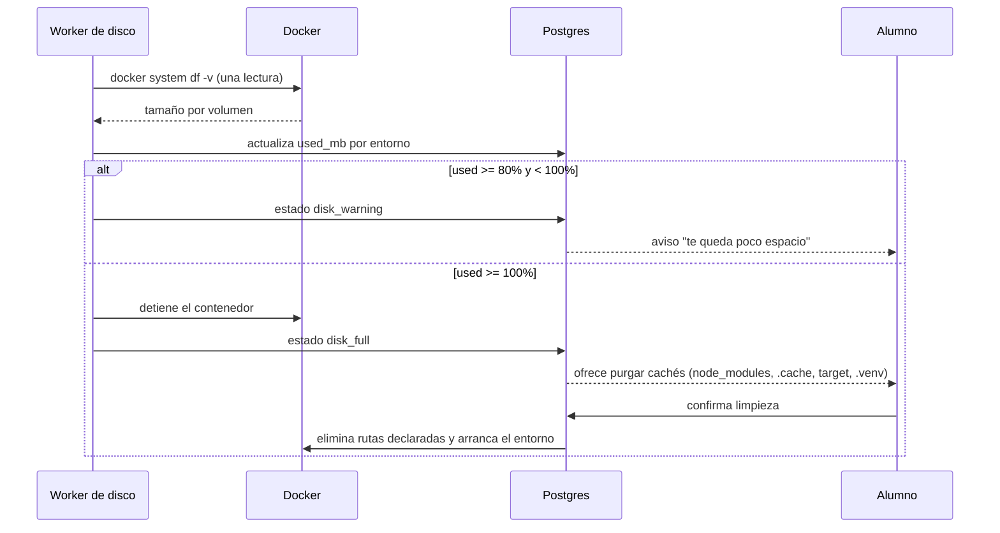

# Design: cuota-de-disco-por-entorno

## Technical Approach

Tres piezas independientes que se pueden entregar por separado:

1. **Limpieza de huérfanos**, operativa y con auditoría: volúmenes con `LINK=0`, caché de
   build e imágenes sin contenedor.
2. **Cuota blanda con aplicación**: el daemon informa el tamaño por volumen
   (`docker system df -v`), un worker lo registra, y la plataforma avisa y luego detiene.
3. **Separación de almacenamiento**: la base de notas en su propio volumen lógico; los
   volúmenes de entorno, en un volumen lógico XFS con `prjquota` cuando exista.

La cuota dura queda como camino condicionado: se aplica cuando exista el volumen lógico
XFS. Mientras tanto, la cuota blanda es la única que existe y así se documenta.

## Architecture Decisions

| Decision | Options | Tradeoff | Choice |
|---|---|---|---|
| Mecanismo de cuota | (a) `StorageOpt size` (b) cuota por proyecto XFS (c) medición con aplicación | (a) no cubre volúmenes nombrados y exige XFS; (b) exige volumen lógico nuevo; (c) no impide pasarse entre mediciones | (c) ahora, (b) cuando exista el volumen XFS. Se documenta como cuota blanda, nunca como dura |
| Cómo se mide | (a) `du` sobre `/var/lib/docker/volumes` (b) `docker system df -v` (c) un contenedor auxiliar que recorre el volumen | (a) recorrer 168 volúmenes cuesta I/O y necesita root; (c) abre un contenedor por medición | (b): el daemon ya tiene el dato por volumen y no requiere privilegios de archivos |
| Qué pasa al 100% | (a) montar en solo lectura (b) detener el contenedor y ofrecer limpieza (c) solo avisar | (a) deja al alumno sin poder borrar; (c) no frena nada | (b): el entorno queda en estado `disk_full` y la interfaz ofrece purgar cachés |
| Techo por entorno | (a) constante (b) política del servidor (c) por plantilla | (a) no se puede ajustar por nodo; (c) cada docente podría pedir 50 GB | (b): `policies.disk_quota_mb`, con el valor salido de la medición |
| Base de notas | (a) mismo sistema de archivos (b) volumen lógico propio (c) disco externo | (a) es el riesgo actual; (c) agrega dependencia de hardware | (b): un volumen lógico propio dentro del mismo VG, o el HDD de datos fríos si el VG no tiene espacio |
| Borrado de huérfanos | (a) manual (b) worker automático (c) manual con lista y auditoría | (b) puede borrar algo que un entorno en creación todavía no reclamó | (c), y el worker solo se habilita después de una corrida manual limpia |

## Estados

`running` → `disk_warning` (≥80%) → `disk_full` (≥100%) → vuelve a `running` cuando el
tamaño baja del 80% tras la limpieza. El bloqueo no borra el entorno ni el volumen.

## Secuencia



## Contratos

```go
type DiskUsage struct {
    EnvironmentID string `json:"environment_id"`
    UsedMB        int64  `json:"used_mb"`
    LimitMB       int64  `json:"limit_mb"`
    Percent       int    `json:"percent"`
    State         string `json:"state"` // ok | warning | full
}
```

Política: `disk_quota_mb` (0 = sin cuota), `disk_warning_pct` (80), `disk_block_pct` (100).

## Verificación

| Capa | Qué se prueba | Cómo |
|---|---|---|
| Unidad (Go) | cálculo de estado por porcentaje y umbrales | tabla, sin Docker |
| Unidad (Go) | el selector de huérfanos descarta todo volumen con `LINK > 0` y todo nombre de entorno activo | repo falso con volúmenes mezclados |
| Integración (Go) | medición real con un volumen de prueba y transición a `disk_warning` | `TEST_DB_DSN` + Docker local |
| Manual (servidor) | limpieza de huérfanos sobre el nodo: lista previa, espacio recuperado y auditoría | corrida documentada en `capacidad.md` |
| Manual (servidor) | arranque de la base desde el volumen lógico nuevo y vuelta atrás | ventana de mantenimiento con respaldo verificado |

## Datos de partida del nodo

- 34 GB libres de 98 GB.
- 19 GB recuperables en volúmenes sin contenedor.
- 3,6 GB recuperables en imágenes.
- Techo por entorno: a fijar con la medición de tamaño por práctica; la referencia de
  arranque es (34 GB + 19 GB recuperados) × 0,85 ÷ alumnos esperados.
