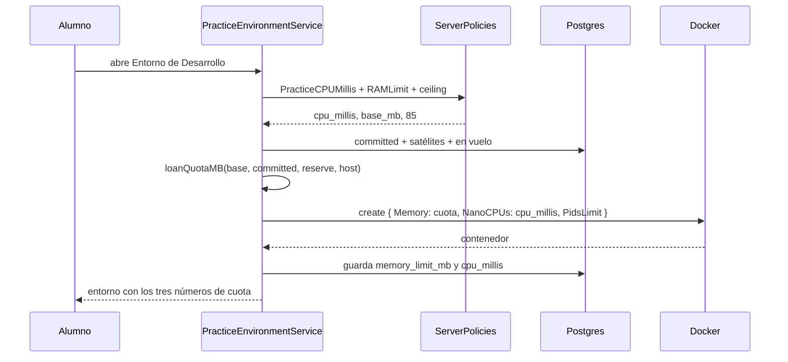

# Design: dimensionamiento-practica-ram-cpu

## Technical Approach

Dos partes separadas. Primero, **medir**: el protocolo de `medicion.md` produce los números
y no se toca código de límites hasta tenerlos. Segundo, **aplicar**: el límite de CPU entra
como política del servidor con un valor por defecto conservador y apagable, y la base de
memoria y los perfiles del préstamo se ajustan en una sola constante. La interfaz muestra
los tres números de cuota con nombre propio.

El límite de CPU va en la política y no en el código porque el valor depende del nodo: un
servidor de 16 núcleos y uno de 4 no pueden compartir la misma constante.

## Architecture Decisions

| Decision | Options | Tradeoff | Choice |
|---|---|---|---|
| Dónde vive el límite de CPU | (a) constante en `docker_container.go` (b) política del servidor (c) plantilla | (a) repite el problema que ADR-082 corrigió; (c) pone una decisión de nodo en manos del docente | (b): `policies.practice_cpu_millis`, con `0` = sin límite |
| Mecanismo de límite | (a) `CpuShares` (b) `NanoCPUs` (c) ambos | (a) es peso relativo y no acota el pico: un solo entorno sigue tomando todo | (b): cuota absoluta; `CpuShares` queda para priorizar el backend si la medición lo pide |
| Momento de aplicación | (a) al crear (b) en caliente | (b) exige recrear el contenedor y pierde estado del IDE | (a), igual que la cuota de memoria; los entornos vivos conservan su límite hasta recrearse |
| Cómo se elige la base de memoria | (a) mantener 512 (b) media de consumo (c) p95 + 25% redondeado al perfil | (b) deja fuera al 5% que más consume y produce OOM | (c), con la regla escrita en `medicion.md` |
| Reconciliación en la interfaz | (a) mostrar solo `memory_limit_mb` (b) mostrar solo el perfil de la plantilla (c) los tres con nombre | (a) oculta el techo declarado; (b) promete lo que no se aplicó | (c): perfil declarado, cuota concedida y límite real |
| PidsLimit | (a) incluirlo ahora (b) dejarlo fuera | (a) es un control de seguridad que el contenedor de revisión ya tiene | (a): mismo valor que el entorno de revisión, salvo que la medición muestre que corta compilaciones |

## Cambios por capa

- **Dominio:** `DefaultServerPolicies().PracticeCPUMillis` y los perfiles del préstamo en
  `practice_environment_capacity.go`. Sin constantes nuevas en `docker_container.go`.
- **Servicios:** `resolvePracticeCPUMillis` lee la política y la pasa al config del
  contenedor; la admisión no cambia de forma.
- **Infraestructura:** `StartPracticeEnvironmentContainer` aplica `NanoCPUs` y `PidsLimit`
  desde el config; `UpdateContainerMemory` sigue sin tocar CPU.
- **Entrega:** el DTO del entorno expone `memory_limit_mb` (ya existe), `memory_profile_mb`
  (lo declarado por la plantilla) y `cpu_millis`.
- **Frontend:** la ficha del entorno y la vista del docente muestran los tres valores; el
  aviso de cuota menor aparece solo cuando difieren.

## Secuencia de aplicación



## Contratos

```go
type ServerPolicies struct {
    // ... campos existentes
    PracticeCPUMillis int64 `json:"practice_cpu_millis" db:"practice_cpu_millis"`
}

// PracticeCPUMillis = 0 significa sin límite: comportamiento previo al cambio.
// Valor por defecto: el que salga de C3 en medicion.md.
```

```jsonc
// GET del entorno
{
  "memory_limit_mb": 2048,   // cuota concedida por la admisión
  "memory_profile_mb": 4096, // perfil declarado por la plantilla
  "cpu_millis": 1000         // límite real del contenedor
}
```

## Verificación

| Capa | Qué se prueba | Cómo |
|---|---|---|
| Unidad (Go) | `resolvePracticeCPUMillis` con política en 0, en 1000 y ausente | tabla, sin Docker |
| Unidad (Go) | `loanQuotaMB` con la base nueva: perfiles y rechazo sin hueco | extender `TestLoanQuotaMB` |
| Integración (Go) | `HostConfig.Memory`, `NanoCPUs` y `PidsLimit` del contenedor creado | `docker inspect` como en `slice10_tls_hardening_test.go` |
| Integración (Go) | contención: 4 entornos compilando, tiempo de compilación dentro de 1.5× | medición cronometrada, no aserción estricta |
| Unidad (Angular) | los tres números se muestran con nombre y el aviso aparece solo si difieren | `component.spec.ts` |

## Riesgos que la medición debe resolver antes de aplicar

- Si M1 (arranque) supera el perfil más alto del préstamo, el `max-old-space-size` está mal
  calibrado y el OOM aparece al abrir, no al compilar.
- Si M5 muestra que el techo del 85% se alcanza antes de 30 entornos, el número que hay que
  corregir es la base, no el techo.
- Si C3 muestra que con 1 núcleo la compilación se duplica, el límite debe ser 1.5 o 2, y
  eso reduce la cantidad de entornos que compilan a la vez: se documenta como límite del
  nodo.
