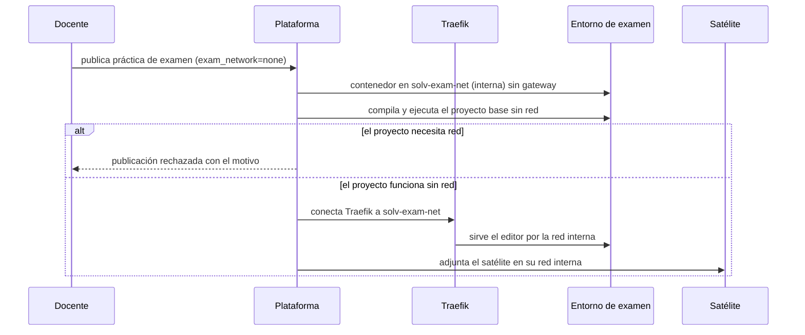

# Design: red-del-examen

## Technical Approach

Este cambio cierra la decisión que `separar-practica-y-examen` dejó abierta: el perfil de
entorno no declara red, y la política vive en `exam_network` del ejercicio. La referencia es
en los dos sentidos, así que ninguna de las dos partes puede cambiar la regla sola.

El examen corre en una red interna de Docker sin puerta de enlace (`--internal`), y Traefik
se conecta a esa red para servir el editor. El contenedor conserva su IP y su puerto 3000,
así que el alumno entra igual; lo que pierde es la ruta por defecto, y con ella la salida.

Cortar la red por completo con `NetworkMode: none` no sirve: el editor dejaría de ser
alcanzable. Por eso la decisión es red interna, no ausencia de red.

## Architecture Decisions

| Decision | Options | Tradeoff | Choice |
|---|---|---|---|
| Mecanismo de corte | (a) `NetworkMode: none` (b) reglas de salida en `DOCKER-USER` (c) red interna sin puerta de enlace | (a) deja el editor inaccesible; (b) son reglas por IP que hay que mantener sincronizadas | (c): el corte lo da la topología, no una regla que puede quedar desactualizada |
| Alcance del corte | (a) por ejercicio (b) por materia (c) global | (b) y (c) obligan a que todo el catálogo funcione sin red | (a), con `none` por defecto |
| Excepción | (a) no existe (b) el docente la declara con motivo | (a) bloquea casos legítimos como un examen que consume una API | (b), auditada y visible para el alumno |
| Verificación previa | (a) confiar en el docente (b) compilar el proyecto base sin red al publicar | (a) traslada el fallo a la ventana del examen | (b): se prueba en la publicación con un contenedor sin puerta de enlace |
| Defensa adicional | (a) solo topología (b) topología más regla en `DOCKER-USER` | (b) suma una regla que hay que mantener | (b) como segunda barrera, con la regla derivada de la etiqueta del contenedor |

## Secuencia

## Contratos

- `exercises.exam_network`: `none` (por defecto) o `egress`.
- `exercises.exam_network_reason`: obligatorio cuando es `egress`.
- El DTO del entorno de examen expone `network_policy` para que la interfaz avise.

## Verificación

| Capa | Qué se prueba | Cómo |
|---|---|---|
| Unidad (Go) | validación de la política y exigencia del motivo en `egress` | tabla, sin Docker |
| Integración (Go) | el contenedor de examen resuelve Traefik y no resuelve un dominio externo | dos verificaciones en el mismo entorno de prueba |
| Integración (Go) | la publicación se rechaza cuando el proyecto base no compila sin red | proyecto de prueba con una dependencia remota |
| Manual (servidor) | el alumno abre el editor, compila y entrega con `exam_network=none` | corrida en la ventana de prueba |
| Manual (servidor) | la excepción `egress` vuelve a dar salida y queda auditada | misma corrida con la excepción activa |
