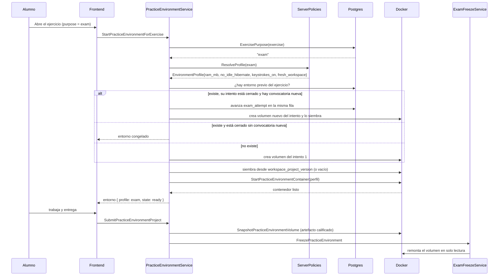

# Design: separar-practica-y-examen

## Technical Approach

El momento no es un dato nuevo que el alumno o el docente elijan: se **deriva** de
`exercise.purpose` (`"class"` o `"exam"`), que ya existe y ya condiciona otras reglas
(`PerStudentSeed` solo se acepta con `purpose = "exam"`). Sobre ese dato se resuelve un
`EnvironmentProfile` que el servicio aplica al abrir el entorno y que la infraestructura
traduce a configuración del contenedor.

El cambio de fondo es el **estado de partida del examen**: para un ejercicio de examen, el
espacio se crea al abrir la ventana, sobre un volumen nuevo del intento actual, desde la
versión base del ejercicio. Un espacio previo del mismo ejercicio no se reutiliza.

No se borra nada: el volumen de la práctica queda como está y el intento anterior queda
congelado y sujeto a la retención existente.

## Architecture Decisions

| Decision | Options | Tradeoff | Choice |
|---|---|---|---|
| Origen del momento | (a) campo editable en el entorno (b) derivado de `exercise.purpose` (c) campo en la plantilla | (a) permite que un alumno quede en modo examen sin serlo; (c) mezcla configuración tecnológica con momento académico | (b): una sola fuente de verdad, ya validada en el dominio |
| Modelo del perfil | (a) constantes dispersas por servicio (b) struct `EnvironmentProfile` con slots (c) enum + switch en docker | (a) repite la uniformidad actual; (c) mete reglas académicas en infraestructura | (b): el dominio declara los slots y la infraestructura solo los consume |
| Estado de partida del examen | (a) reutilizar el volumen del ejercicio (b) vaciar el volumen existente (c) volumen nuevo por intento desde la versión base | (b) es destructivo y no auditable; (a) es el comportamiento actual | (c): aditivo, reversible y deja el intento anterior como evidencia |
| Cupo por momento | (a) fijar 4 GB en práctica aquí (b) dejar el cupo como slot sin número nuevo | (a) mezcla dos cambios y bloquea el rollback | (b): se declara `ram_mb` por perfil; los valores se ajustan en el cambio de dimensionamiento |
| Captura de tecleo | (a) siempre (b) solo en examen, aplicada en el cliente (c) solo en examen, aplicada en el servidor | (b) se puede desactivar desde el navegador; (c) es la única que se puede afirmar | (c): el servidor rechaza eventos de entornos con perfil de práctica |
| Hibernación en examen | (a) mismo worker (b) exención total (c) exención salvo presión de host | (b) permite que el host quede sin memoria durante la ventana | (c): el worker puede hibernar por presión y lo audita, nunca por inactividad |
| Aviso al alumno | (a) redirección silenciosa (b) estado explícito con mensaje | (a) se lee como pérdida de trabajo | (b): `preparing` → `ready` → `closed` |
| Segunda vuelta del examen | (a) reabrir el mismo intento (b) fila nueva por intento (c) avanzar el intento en la misma fila | (a) el alumno rinde recuperando los archivos del examen anterior; (b) choca con `idx_workspaces_practice_scope`, que admite una sola fila por persona, materia y práctica | (c): el intento avanza en la fila existente y el volumen nuevo se siembra desde la versión base, así que el intento anterior queda intacto en su volumen |
| Cuándo hay segunda vuelta | (a) cualquier reapertura del entorno (b) el número de entregas (c) una convocatoria de examen abierta después del cierre | (a) deja reabrir para seguir escribiendo después de entregar; (b) no distingue un recuperatorio de una entrega repetida | (c): la segunda vuelta depende del docente, que abre el aula del recuperatorio. Recargar la página no reabre nada |

## Decisiones que pertenecen a otros cambios

- **Red del examen.** Este cambio no fija la política de red. Se resuelve en
  `openspec/changes/red-del-examen`: `exam_network` por ejercicio con `none` por defecto,
  red interna sin puerta de enlace para no dejar al alumno sin editor, excepción
  declarada por el docente y verificación del proyecto base sin salida al publicar.
  `EnvironmentProfileSpec` no declara política de red, para no tener dos fuentes para la
  misma decisión.
  **Decidido:** la política vive en el ejercicio (`exam_network`, `none` por defecto) y la
  red interna con su proxy de editor quedaron implementadas en el ADR-085.

## Data Model

Migración aditiva e idempotente, sin reescritura de filas:

```sql
ALTER TABLE environments
  ADD COLUMN IF NOT EXISTS environment_profile TEXT NOT NULL DEFAULT 'practice';
ALTER TABLE environments
  ADD COLUMN IF NOT EXISTS exam_attempt INT NOT NULL DEFAULT 0;
```

- `environment_profile`: `practice` | `exam`. Se recalcula al abrir desde
  `exercise.purpose`; el valor persistido es el que se aplicó en la última apertura.
- `exam_attempt`: arranca en `0`; el primer espacio de examen es `1`. Junto con
  `(student_id, subject_id, exercise_id)` forma la clave del volumen del intento.

El volumen del examen usa un sufijo de intento; el nombre del volumen de práctica no
cambia, así que ningún entorno existente se mueve.

## Sequence Diagram



## File Changes

| File | Action | Description |
|---|---|---|
| `backend/migrations/000NN_environment_profile.sql` | Create | Columnas `environment_profile` y `exam_attempt` con default |
| `backend/internal/core/domain/practice_environment.go` | Modify | `EnvironmentProfile`, `EnvironmentProfilePractice/Exam`, slots y `IsExam()` |
| `backend/internal/core/domain/ports.go` | Modify | `ExercisePurposeReader` y `KeystrokeCaptureGate` si el servicio no los recibe ya |
| `backend/internal/core/services/practice_environment_service.go` | Modify | `resolveEnvironmentProfile`, arranque del examen con volumen de intento, guardas de cambio de propósito |
| `backend/internal/core/services/practice_environment_lifecycle.go` | Modify | `HibernatePracticeEnvironment` rechaza hibernación explícita en examen |
| `backend/internal/core/services/qos_worker.go` | Modify | Salta la hibernación por inactividad cuando el perfil activo es examen |
| `backend/internal/core/services/submission_service.go` | Modify | `SaveKeystrokeEvents` rechaza eventos de entornos con perfil de práctica |
| `backend/internal/core/services/practice_environment_submission.go` | Modify | Error accionable cuando la copia excede 4 MB / 800 archivos, con ruta y tamaño |
| `backend/internal/infrastructure/storage/postgres/practice_environment_repository.go` | Modify | Leer y escribir las dos columnas; unicidad por intento |
| `backend/internal/infrastructure/docker/docker_container.go` | Modify | Consumir el perfil (memoria y CPU tal como los declara la política); la red del examen no se toca acá |
| `backend/internal/delivery/http/dto/*` | Modify | Exponer `profile` y `state` en el DTO del entorno |
| `frontend/.../student-exercise-solver/*` | Modify | Estados `preparing` / `ready` / `closed` y aviso de que la práctica sigue intacta |
| `backend/internal/core/services/practice_environment_*_test.go` | Modify | Casos de perfil, intento y captura de tecleo |

## Interfaces / Contracts

```go
type EnvironmentProfile string

const (
    EnvironmentProfilePractice EnvironmentProfile = "practice"
    EnvironmentProfileExam     EnvironmentProfile = "exam"
)

// EnvironmentProfileSpec declara qué cambia por momento. Los valores numéricos
// llegan de la política vigente; este struct no fija ninguno.
type EnvironmentProfileSpec struct {
    Profile             EnvironmentProfile
    RAMMB               int
    IdleHibernation     bool
    HostPressureHibernation bool
    KeystrokeCapture    bool
    FreshWorkspace      bool
    FreezeOnSubmit      bool
}
```

Contrato HTTP: el DTO del entorno agrega `profile` (`practice`|`exam`) y `state`
(`preparing`|`ready`|`closed`). Ningún cliente puede enviar `profile`: el servidor lo
deriva.

## Fit con Capas Hexagonales

- **Dominio:** `EnvironmentProfile` y sus reglas, sin dependencias de Docker ni HTTP.
- **Servicios:** resolución del perfil, decisión de reutilizar o crear espacio, guardas de
  propósito y de captura de tecleo.
- **Infraestructura:** traduce el perfil a `HostConfig` y persiste columnas; no decide
  cuándo un entorno es de examen.
- **Entrega:** solo expone estado; no calcula perfiles.

Restricciones D1-D6 respetadas: sin socket expuesto al alumno, sin dominios hardcodeados,
sin persistencia fuera de PostgreSQL, y el volumen del alumno sigue sin borrarse.

## Testing Strategy

| Layer | What to Test | Approach |
|---|---|---|
| Unit (Go) | `resolveEnvironmentProfile` para `class`, `exam` y propósito vacío (default `class`) | tabla por caso, sin Docker |
| Unit (Go) | examen crea intento nuevo cuando existe uno cerrado; no lo crea dos veces | repo falso con filas preexistentes |
| Unit (Go) | `SaveKeystrokeEvents` rechaza eventos de perfil práctica y acepta de examen | repo falso, mismo patrón que `submission_keystroke_authz_test.go` |
| Unit (Go) | QoS no hiberna por inactividad en examen y sí lo hace en práctica | worker con reloj falso |
| Integración (Go) | volumen de intento nuevo + siembra desde la versión base + congelado al entregar | `TEST_DB_DSN` + Docker local, patrón de `exam_freeze_docker_e2e_test.go` |
| Unit (Angular) | los tres estados del aviso y el texto "tu práctica sigue intacta" | `component.spec.ts` con Signals |

## Threat Matrix

| Amenaza | Vector | Control |
|---|---|---|
| Alumno fuerza perfil de práctica en un examen | DTO manipulado | El perfil se deriva en el servidor desde `exercise.purpose`; el DTO es de solo lectura |
| Alumno desactiva la captura de tecleo | Cliente modificado | El servidor rechaza eventos fuera del perfil de examen; no depende del cliente |
| Alumno reutiliza un espacio preparado | Apertura previa del ejercicio de examen | El espacio de examen se crea en la apertura de la ventana sobre un volumen de intento nuevo |
| Docente cambia `purpose` a mitad de examen | Endpoint de ejercicios | Guarda: no se permite con entornos `running`; se exige confirmación auditada |
| Copia entregada vacía o truncada | Límite de 4 MB / 800 archivos | Error accionable con ruta y tamaño; la entrega no se registra a medias |
