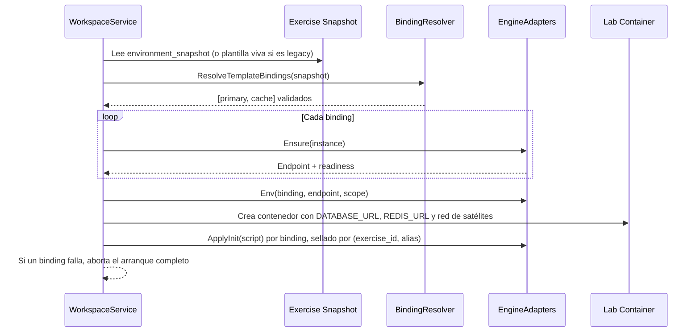

# Diseño Técnico: Servicios Satélite por Rol, Pin del Entorno y Contratos de Capacidad y Aislamiento

## 1. Encaje Arquitectónico y Límites Hexagonales

Este diseño respeta la arquitectura hexagonal de SOLV y el ADR-050:

- **`core/domain`:** roles y bindings puros, invariantes de cardinalidad, normalización de `category` heredado, tipos de init y de aislamiento, cálculo de capacidad. Sin dependencias de infraestructura.
- **`core/services`:** resolución de bindings contra el catálogo, orquestación del arranque, pin del entorno al publicar, cálculo de piso vital, provisión de aislamiento.
- **`infrastructure/storage/postgres`:** persistencia de `services_config` (JSON existente), `template_components.service_role`, `lab_templates.stack_config` y `exercises.environment_snapshot`.
- **`infrastructure/docker`:** adaptadores de motor (spec de contenedor, readiness, ACL/roles, init) detrás de una interfaz de dominio.
- **`delivery/http`:** sin endpoints nuevos obligatorios; el contrato de plantillas incorpora los bindings y la validación responde `422` con códigos estables.

## 2. Estado Actual y Brechas

| Pieza | Hoy | Brecha |
|---|---|---|
| Selección | `selectedDatabaseId` único | Un solo servicio |
| Payload | `stack_config.database_id` + un `ServiceRequirement` | No expresa roles ni N bindings |
| Validación | `CreateOfficialTemplate` solo vacía servicios en juez/dual | Acepta motores desconocidos, duplicados y dos primarios |
| Resolución | `templateSatelliteEngine` primer match | Ignora el resto de la lista |
| Aprovisionamiento | `ensureExerciseSatelliteDB` un motor | No inyecta dos entornos ni espera dos readiness |
| Scale-to-zero | `managedEngineForWorkspace` un motor | Apagaría un motor en uso |
| Memoria | `db.ram_delta_mb` por alumno + tabla hardcodeada | Cobra N veces un servicio compartido |
| Reproducibilidad | Plantilla mutable, sin snapshot | Editar cambia ejercicios publicados |
| Aislamiento | Prefijo en Redis, sin auth en Mongo, superusuario en PostgreSQL | No verificable |
| Init | Solo MySQL/MariaDB y PostgreSQL | Mongo/Redis lo ignoran en silencio |
| Catálogo | `managedSatelliteSpec` hardcodea imagen y techo | El catálogo no gobierna la ejecución |

## 3. Modelo de Dominio

```go
type ServiceRole string

const (
    RolePrimaryDatabase ServiceRole = "primary_database"
    RoleCache           ServiceRole = "cache"
)

// ServiceRequirement es la forma persistida y de API; conserva Category como alias heredado.
type ServiceRequirement struct {
    Role        ServiceRole `json:"role,omitempty"`
    Engine      string      `json:"engine"`
    ComponentID string      `json:"component_id,omitempty"`
    Version     string      `json:"version,omitempty"`
    EnvAlias    string      `json:"env_alias,omitempty"`
    Category    string      `json:"category,omitempty"`
}

// ResolvedServiceBinding es la forma normalizada que consume el pipeline y el adaptador.
type ResolvedServiceBinding struct {
    Role        ServiceRole
    Engine      string
    ComponentID string
    Version     string
    EnvAlias    string
    InitKind    InitKind
    Adapter     EngineAdapter
}

type InitKind string

const (
    InitNone      InitKind = "none"
    InitSQL       InitKind = "sql"
    InitMongoJS   InitKind = "mongo-js"
    InitRedisCmds InitKind = "redis-cmds"
)
```

`ServiceRequirement` expone `EffectiveRole()`:

1. Si `role` está presente, se usa.
2. Si no, `category: "cache"` o `engine: "redis"` resuelven `cache`.
3. En cualquier otro caso, `primary_database`.

`NormalizeAndValidateServices(*ServicesConfig) error`:

- Descarta entradas vacías y `engine: "none"`.
- Canoniza el motor con `CanonicalServiceEngine`.
- Exige motor soportado y rol coherente.
- Exige como máximo una `primary_database`.
- Exige un binding por motor y un `env_alias` único (default: `db`, `cache`).
- Devuelve códigos estables: `unsupported_service_engine`, `service_role_mismatch`, `multiple_primary_database`, `duplicate_service_engine`, `duplicate_service_alias`, `service_init_not_supported`.

## 4. Adaptador de Motor

```go
type EngineAdapter interface {
    Engine() string
    Capabilities() EngineCapabilities // expected_mb, reserve_mb, init_kinds, isolation, provisioning_mode
    Ensure(ctx context.Context, instance InstanceKey) (Endpoint, error)
    Env(binding ResolvedServiceBinding, endpoint Endpoint, scope IsolationScope) []string
    ApplyInit(ctx context.Context, binding ResolvedServiceBinding, endpoint Endpoint, scope IsolationScope, script string) error
    Stop(ctx context.Context, instance InstanceKey) error
}
```

- `InstanceKey = {engine, major, profile}`; en la fase 4 se usa `engine` y un único perfil, y la clave queda preparada para la fase 7.
- El registro es un `map[string]EngineAdapter` construido en `cmd/api/main.go`; no hay carga dinámica.
- Los adaptadores reemplazan `managedSatelliteSpec`, el `switch` de `provisionManagedSatellite` y las ramas de init. La imagen, el techo y el readiness salen del adaptador; el catálogo solo aporta disponibilidad y metadata.
- PostgreSQL de aula es un adaptador `shared_host`; SQLite es `embedded`; MySQL, MariaDB, MongoDB y Redis son `managed_container`.

## 5. Flujo de Arranque



## 6. Persistencia y Migraciones

No se crea una tabla de bindings: la plantilla publicada es un artefacto y su lista vive en `lab_templates.services_config`. Cambios de esquema:

```sql
ALTER TABLE template_components
    ADD COLUMN IF NOT EXISTS service_role VARCHAR(32) NOT NULL DEFAULT '';

ALTER TABLE exercises
    ADD COLUMN IF NOT EXISTS environment_snapshot JSONB;
```

- `service_role` se deriva del motor para las filas existentes (`redis → cache`, resto `primary_database`) en la misma migración.
- `environment_snapshot` es nullable: los ejercicios anteriores usan el fallback a la plantilla viva.
- `stack_config.database_id` se mantiene como alias de lectura; el Studio nuevo escribe `services: [...]` y puede seguir escribiendo `database_id` para clientes viejos.

## 7. Contrato de API

`CreateOfficialTemplateDTO` y `UpdateOfficialTemplateDTO` aceptan:

```json
{
  "services_config": {
    "services": [
      { "role": "primary_database", "engine": "postgres", "component_id": "...", "env_alias": "db" },
      { "role": "cache", "engine": "redis", "component_id": "...", "env_alias": "cache" }
    ]
  },
  "stack_config": {
    "services": [
      { "role": "primary_database", "component_id": "..." },
      { "role": "cache", "component_id": "..." }
    ]
  }
}
```

- La validación responde `422` con `error.code` estable y un mensaje en español.
- `GET /api/v1/admin/templates/capabilities` expone, por motor, `role`, `expected_mb`, `reserve_mb`, `init_kinds`, `isolation`, `provisioning_mode` y `version` del adaptador.
- El copiloto devuelve `services: [...]`; se mantiene `database_slug` como alias de lectura durante una versión.

## 8. Capacidad y Memoria

- Por laboratorio: `editor_base_mb + runtime + web + addons + clientes`. Nada de satélites.
- Por nodo: `Σ reserve_mb` de cada identidad de satélite encendida o reservada.
- Capacidad del aula: `(allocatable_mb − Σ reserve_mb) / per_lab_quota_mb`.
- El piso vital de la plantilla usa los mismos valores del adaptador; se elimina la tabla `switch` de `calculateMinimumVitalFloorMB`.
- La interfaz muestra `expected_mb` con la etiqueta «nodo» y aclara que se libera cuando no hay laboratorios activos.
- La admisión consulta el estado de los satélites antes de aceptar un laboratorio; si no puede reservar, responde un error de capacidad, no un OOM.

## 9. Aislamiento

`IsolationScope = {tenant_id, student_id, subject_id, service_alias}`.

- **PostgreSQL:** `CREATE ROLE u_<hash> LOGIN PASSWORD ...`, `CREATE DATABASE ... OWNER ...`, `REVOKE CONNECT ON DATABASE ... FROM PUBLIC`, `GRANT CONNECT` solo al rol. El DSN administrativo es distinto del DSN de la aplicación y no se inyecta al laboratorio.
- **MySQL / MariaDB:** se conserva base + usuario por scope; la contraseña se deriva con `HMAC(secret, tenant + ":" + role + ":" + engine + ":" + student + ":" + subject)`.
- **MongoDB:** el contenedor arranca con `--auth` y un usuario administrativo desde secreto; por scope se crea un usuario con `readWrite` solo sobre su base.
- **Redis:** `--aclfile` con un usuario por scope, `~<prefix>:*` y `-flushall -flushdb -config -shutdown -debug`. El prefijo deja de ser una sugerencia del cliente y pasa a ser una restricción del servidor.
- Si el adaptador no puede aplicar su contrato de aislamiento, `Ensure` falla y el arranque se aborta.

## 10. Interfaz

- **Columna 3 «Datos y servicios»:** bloque «Base de datos principal» (radio, incluye «Sin base de datos») y bloque «Servicios auxiliares» (checkbox por rol, Redis primero). Cada tarjeta muestra rol, versión y costo del nodo.
- El resumen lateral lista los bindings con su alias de entorno.
- El modal de solicitud docente reutiliza el mismo contrato; el copiloto propone `services` y marca los motores faltantes.
- Sin cambios en la semántica visual de estados ni en los tokens.

## 11. Compatibilidad y Rollback

- **Lectura heredada:** `category`, `database_id` y `database_slug` se aceptan como alias; un payload viejo sigue funcionando con un binding primario.
- **Tope temporal:** hasta que la fase 4 esté desplegada, la validación mantiene un solo binding por plantilla. Retirar el tope antes deja la API aceptando dos servicios que el pipeline todavía ignora; el tope se elimina junto con el aprovisionamiento de N bindings.
- **Escritura nueva:** el Studio escribe `services` y `role`; el backend normaliza.
- **Rollback:** el cambio es reversible por fase. Las migraciones son aditivas (`service_role` con default, `environment_snapshot` nullable) y no borran datos. Revertir la fase 5 exige volver a las credenciales anteriores, que se reescriben en el siguiente arranque; hay que probarlo con un laboratorio real antes de desplegar.
- **Riesgo aceptado:** cambiar la derivación de credenciales invalida las claves vigentes hasta el próximo arranque de cada laboratorio. Se documenta en la fase 5.

## 12. Pruebas

- **Dominio:** cardinalidad, roles, alias, normalización heredada, init no soportado.
- **Servicios:** resolución de dos bindings, arranque con un motor caído, scale-to-zero con dos laboratorios, pin y fallback legacy, capacidad con reserva.
- **Adaptadores:** contrato de cada motor con un orquestador simulado; ACL/roles con comandos reales en integración.
- **Frontend:** dos bloques, reemplazo de la base principal, payload con dos bindings, etiqueta de costo del nodo, copiloto y modal docente.
- **Integración:** PostgreSQL con dos roles, Redis con ACL y dos prefijos, MongoDB con auth y dos bases.

## 13. Fuera de Alcance

- Juez efímero con servicios.
- Publicación multi-nodo y colocación de satélites por nodo.
- Versionado completo de plantillas.
- Manifiesto de servicios dentro del workspace.
- Métricas nuevas de satélites (se apoyan en ADR-049 en una fase posterior).
