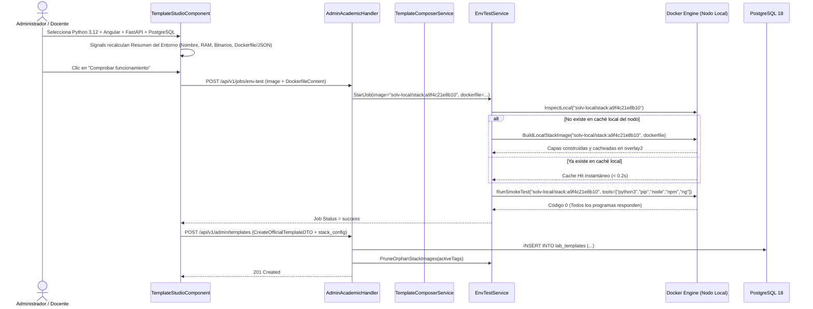

# Diseño Técnico: Constructor de Entornos Componibles por Catálogo de Tecnologías y Construcción Local Determinista de Imágenes (`solv-local/stack:<sha256>`)

## 1. Encaje Arquitectónico y Límites Hexagonales

Este diseño respeta la Arquitectura Hexagonal de SOLV (`core/domain`, `core/services`, `infrastructure/`, `delivery/http`) y las decisiones del sistema (ADR-000, ADR-030, ADR-043, ADR-046):

- **`core/domain` (`admin_governance.go`, `template_component.go`):**
  - Define los modelos puros de dominio: `TemplateComponent`, `ComponentLayer` (`runtime` | `addon` | `database`), `InstallMode` (`none` | `pip` | `npm` | `apt` | `custom`), `StackConfig` (almacenado en `lab_templates.stack_config` y `template_models.stack_config`) y `ComposedTemplatePlan`.
  - Contiene funciones puras de validación: `ValidatePackageNames(pkgs []string) error` (aplicando `^[a-zA-Z0-9@_./=<>-]+$`) y cálculo determinista de firma SHA-256 `ComputeStackSignature(baseImage string, layers []string) string`.
- **`core/services` (`template_composer_service.go`, `env_test_service.go`, `admin_governance_service.go`):**
  - `TemplateComposerService`: Resuelve un `StackConfig` + `TargetEnvironment` contra `TemplateComponentRepository` en un `ComposedTemplatePlan` (`ResolvedImage`, `NeedsLocalBuild`, `DockerfileContent`, `SetupScript`, `ToolsDeclared`, `DefaultEntrypoint`, `RecommendedRamMB`, `ServicesConfig`, `SignatureHash`).
  - `EnvTestService`: Extendido con `ImageBuilderPort` (`BuildLocalStackImage(ctx, tag, dockerfileContent, progressCb)` y `PruneOrphanStackImages(ctx, activeTags)`). Cuando una tarea contiene un `DockerfileContent` multicapa para `solv-local/stack:<hash>`, `EnvTestService` verifica si el tag ya existe en la caché local; si no existe, construye la imagen en el nodo antes de ejecutar el contenedor de verificación de herramientas.
- **`infrastructure/` (`storage/postgres/`, `docker/`):**
  - Migración en `migrations/00022_template_components_and_studio.sql` que crea `template_components`, carga el catálogo tecnológico inicial (Python, Node.js, Java, Go, C/C++, Rust, Angular, React, Vue, FastAPI, Flask, Django, Streamlit, Maven, TypeScript, Ciencia de Datos, SQLite, PostgreSQL, MySQL, Redis) y agrega `stack_config JSONB NOT NULL DEFAULT '{}'::jsonb` a `lab_templates` y `template_models`.
  - El adaptador Docker implementa `BuildLocalStackImage` (ejecutando `ImageBuild` con el `Dockerfile` en memoria hacia el tag `solv-local/stack:<hash>`) y `PruneOrphanStackImages` (listando imágenes `solv-local/stack:*` y eliminando las que no estén en `activeTags`).
- **`delivery/http` (`admin_academic_handler.go`, `router.go`):**
  - `GET /api/v1/admin/template-components` (accesible para roles autenticados `admin` y `teacher`).
  - `POST /api/v1/admin/template-components` (`admin`, registra un componente tecnológico mediante modo asistido `pip`/`npm`/`apt` o instrucción personalizada).
  - `PUT /api/v1/admin/template-components/{id}` y `DELETE /api/v1/admin/template-components/{id}`.
  - `POST /api/v1/admin/templates/compose-preview` (`admin` y `teacher`, devuelve el `ComposedTemplatePlan` determinista).
  - `PUT /api/v1/admin/templates/{id}` (`admin`, edición sin corte de metadatos, RAM y `stack_config`).

---

## 2. Esquema de Base de Datos

```sql
CREATE TABLE IF NOT EXISTS template_components (
    id UUID PRIMARY KEY DEFAULT gen_random_uuid(),
    tenant_id UUID NOT NULL DEFAULT '00000000-0000-0000-0000-000000000001',
    slug VARCHAR(64) NOT NULL,
    layer VARCHAR(20) NOT NULL CHECK (layer IN ('runtime', 'addon', 'database')),
    sub_category VARCHAR(30) NOT NULL DEFAULT 'general',
    name VARCHAR(120) NOT NULL,
    description TEXT NOT NULL DEFAULT '',
    icon_key VARCHAR(40) NOT NULL DEFAULT 'docker',
    base_image VARCHAR(255) NOT NULL DEFAULT '',
    compatible_runtimes JSONB NOT NULL DEFAULT '[]'::jsonb,
    install_mode VARCHAR(20) NOT NULL DEFAULT 'none' CHECK (install_mode IN ('none', 'pip', 'npm', 'apt', 'custom')),
    package_names JSONB NOT NULL DEFAULT '[]'::jsonb,
    build_layer_snippet TEXT NOT NULL DEFAULT '',
    setup_snippet TEXT NOT NULL DEFAULT '',
    judge_entrypoint VARCHAR(255) NOT NULL DEFAULT '',
    tools_provided JSONB NOT NULL DEFAULT '[]'::jsonb,
    service_engine VARCHAR(40) NOT NULL DEFAULT '',
    ram_delta_mb INT NOT NULL DEFAULT 0,
    is_system BOOLEAN NOT NULL DEFAULT FALSE,
    is_active BOOLEAN NOT NULL DEFAULT TRUE,
    sort_order INT NOT NULL DEFAULT 100,
    created_at TIMESTAMPTZ NOT NULL DEFAULT NOW(),
    updated_at TIMESTAMPTZ NOT NULL DEFAULT NOW(),
    UNIQUE (tenant_id, slug)
);

ALTER TABLE lab_templates
    ADD COLUMN IF NOT EXISTS stack_config JSONB NOT NULL DEFAULT '{}'::jsonb;

ALTER TABLE template_models
    ADD COLUMN IF NOT EXISTS stack_config JSONB NOT NULL DEFAULT '{}'::jsonb;
```

### Estructura de `stack_config` JSONB
```json
{
  "mode": "visual",
  "runtime_id": "rt-python-312",
  "web_platform_id": "web-angular",
  "addon_ids": ["ad-fastapi"],
  "database_id": "db-mysql"
}
```

---

## 3. Diagrama de Secuencia: Composición, Construcción Local y Publicación Multicapa



---

## 4. Construcción Local Determinista y Síntesis Asistida de Paquetes

### 4.1 Modo Asistido de Paquetes (`pip` | `npm` | `apt`)
Cuando un administrador registra un componente tecnológico con `install_mode`:
- `pip`: Genera `RUN pip install --no-cache-dir <pkg1> <pkg2>`
- `npm`: Genera `RUN npm install -g --no-audit --no-fund <pkg1> <pkg2>`
- `apt`: Genera `RUN apt-get update && apt-get install -y --no-install-recommends <pkg1> <pkg2> && rm -rf /var/lib/apt/lists/*`

### 4.2 Composición entre Ecosistemas (ej. Python Principal + Plataforma Web Angular/React)
- Cada componente de plataforma web (`Angular`, `React + Vite`, `Vue 3`) incluye su propio `build_layer_snippet` autocontenido que instala `nodejs` y `npm` (además de `@angular/cli` para Angular) en la imagen si el lenguaje base no es `node:*`.
- Debido a que las capas se construyen localmente en `solv-local/stack:<sha256>` una única vez al verificar y publicar la plantilla, los estudiantes abren su contenedor con `python3` y `ng`/`node` preinstalados en `/usr/local/bin` o `/usr/bin`, sin descargas de red durante la clase.

---

## 5. Arquitectura Frontend (Angular 22 Standalone y Signals)

### 5.1 Componentes Nuevos y Actualizados (Sin prefijo `solv-`)
1. **`TechLogoComponent` (`selector: 'tech-logo'`):**
   - Elimina el bloque condicional `@switch` inline de SVGs codificados en el componente.
   - Resuelve las claves conocidas (`KNOWN_TECH_ICON_KEYS`) hacia el paquete de activos estáticos vectoriales oficiales en `frontend/public/tech-icons/<slug>.svg` (`python`, `node`, `typescript`, `java`, `go`, `cpp`, `rust`, `php`, `dotnet`, `angular`, `react`, `vue`, `nextjs`, `vite`, `fastapi`, `django`, `flask`, `spring`, `laravel`, `streamlit`, `bun`, `deno`, `postgres`, `mysql`, `mariadb`, `sqlite`, `mongodb`, `redis`, `git`, `db`, `docker`).
   - Acepta también rutas o URLs personalizadas (`/tech-icons/...`, `https://...`, `http://...`, `data:image/svg+xml,...`) mediante `iconType` o `customIconUrl`.
   - Mantiene estado reactivo `imgLoadFailed = signal<boolean>(false)` que ante claves desconocidas o eventos `(error)` en la etiqueta `` degrada automáticamente al monograma determinista de 2 letras estilizado únicamente con tokens CSS del sistema de diseño.
   - Es 100% compatible con despliegues On-Premise desconectados (los activos oficiales se sirven localmente desde `public/tech-icons/`) y con despliegues en nube o híbridos.
2. **`TemplateStudioComponent` (`selector: 'template-studio'`):**
   - Rutas `/admin/plantillas/nueva` y `/admin/plantillas/:id/editar` en `app.routes.ts`.
   - Reemplaza el modal de 6 pasos mediante Signals (`signal`, `computed`) con estado inicial limpio (`selectedRuntimeId = null`, `selectedCategoryId = null`, `dockerImage = ''`, sin botones de combinaciones predefinidas en código) para propósito, **Modo Visual** / **Modo Avanzado (Dockerfile / Scripts)**, selección por columnas (`selectedStackComponents`, `recalculateFromVisualSelection`), filtrado contextual de complementos y panel lateral fijo de **Resumen del Entorno** y manifiesto.
   - Mantiene las Columnas 1 y 2 abiertas al catálogo administrativo mediante `+ Nuevo`, mientras que la Columna 3 (`Base de Datos`) prescinde del botón `+ Nuevo` y construye su lista desde `RuntimeCapabilities.satellite_services` (ADR-045), mostrando versiones reales detectadas en el motor (`SHOW server_version;` vía `PostgresVersionProbe`), impacto de memoria (`+0 MB RAM` para SQLite3, `~50 MB RAM` para PostgreSQL) y deshabilitando motores no aprovisionados en el nodo (`No habilitado en este nodo`).
   - En la Sección 3 aplica el modelo de memoria por procesos residentes (sin inflación lineal por librerías en disco), expone los 5 niveles de ADR-045 (`384`, `512`, `768`, `1024`, `2048 MB` en IDE; `128`, `256`, `512 MB` en Juez) con insignia `Sugerido` y simulador de alumnos simultáneos, barra gráfica segmentada `.memory-bar` (`IDE Web 210 MB` / `Sandbox Juez 32 MB`, servicio de base de datos y memoria libre para compilación y código del alumno), candados de seguridad (`isRamBelowFloor`, `isRamExceedingHost`, validados también en `AdminGovernanceService`) y persistencia de `resource_profile: { min_mb, high_mb, max_mb }`.
3. **`ComponentFormModalComponent` (`selector: 'component-form-modal'`):**
   - Utiliza `<modal-shell>` (`shared/components/modal-shell`).
   - Inicia con clave de icono neutra (`docker`) y compatibilidad vacía (`''`) sin preseleccionar tecnologías por defecto, autocompletando el icono oficial si el nombre escrito coincide con una tecnología conocida de `CURATED_TECH_ICONS`, o permitiendo elegir un icono de la galería visual o ingresar una URL/ruta `.svg` personalizada (`customIconUrl`) con vista previa en vivo mediante `<tech-logo [iconType]="effectiveIconKey()" [size]="32" />`. Reemplaza la entrada numérica manual de MB por el selector `Perfil de Consumo en Memoria` (`library` -> `0 MB`, `devserver` -> `256 MB`, `heavy` -> `384 MB` en `addon`; `light` -> `384 MB`, `standard` -> `512 MB`, `heavy` -> `1024 MB` en `runtime`). Expone exclusivamente las capas `runtime` y `addon`, informando que los motores de base de datos dependen de la infraestructura del nodo y los drivers u ORMs se registran como `addon`.
4. **`ModelLibraryComponent` (`selector: 'model-library'`):**
   - Incorpora la pestaña **Catálogo de Tecnologías** (`'components'`) junto a `'models'` y `'categories'` para gestionar el catálogo de componentes tecnológicos en `/admin/modelos-categorias`.
5. **`TemplateRequestModalComponent` (`/teacher/templates`):**
   - Inicia sin tecnología ni imagen preseleccionada (`selectedRuntimeId = null`, `dockerImage = ''`), exigiendo que el docente elija el lenguaje principal de su materia antes de pasar al paso de justificación.
6. **Contratos de Dominio (`features/admin/models/admin-templates.models.ts`) y `AdminTemplatesService`:**
   - Todas las interfaces, tipos y DTOs de plantillas, modelos, categorías, capacidades de nodo y catálogo de tecnologías (`TemplateComponent`, `TechCatalogItem`, `TemplateComponentItem`, `StackConfig`) viven en `frontend/src/app/features/admin/models/admin-templates.models.ts`.
   - `AdminTemplatesService` se mantiene estrictamente como adaptador de transporte HTTP sin arreglos estáticos ni catálogos en memoria; tanto el catálogo de tecnologías (`getTechCatalog`) como las capacidades y servicios satélite (`GET /api/v1/admin/templates/capabilities`) provienen únicamente del backend. Ante errores de red o del servidor, las vistas informan el estado de error al usuario sin inyectar datos simulados en memoria.
